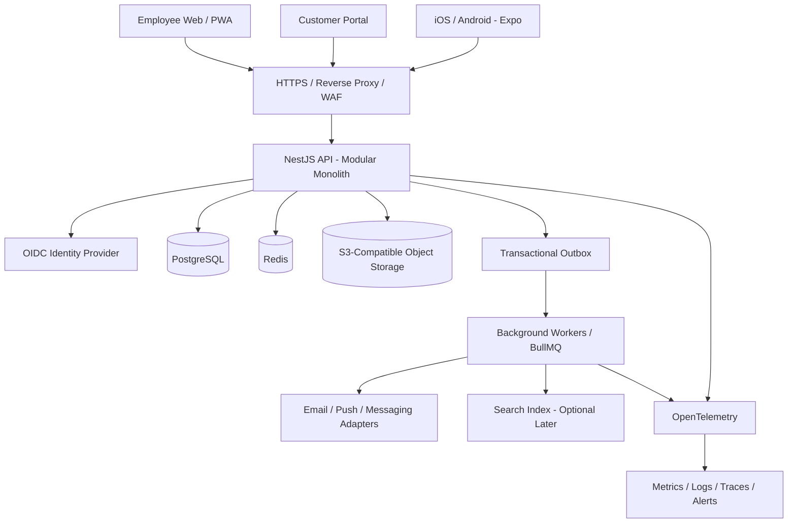
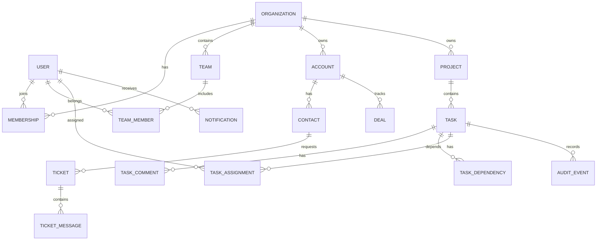
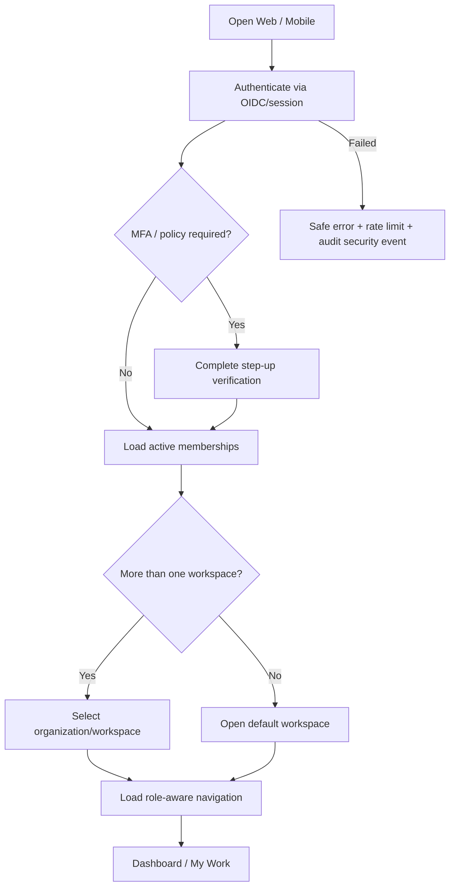
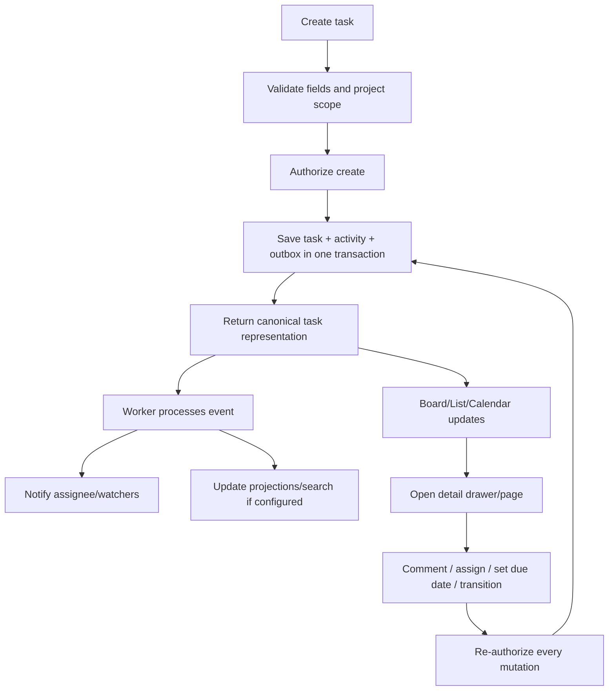
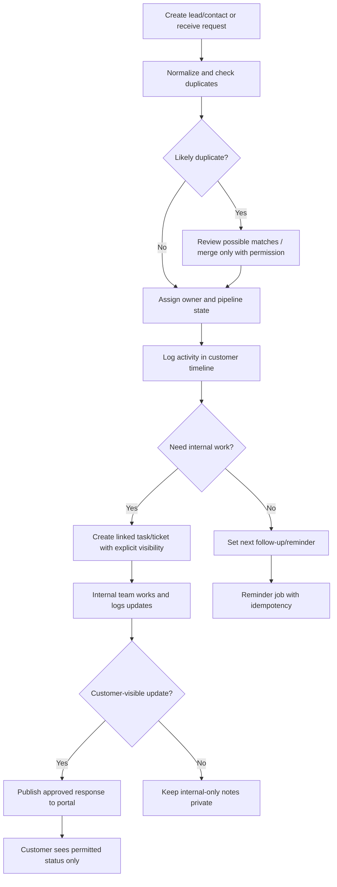
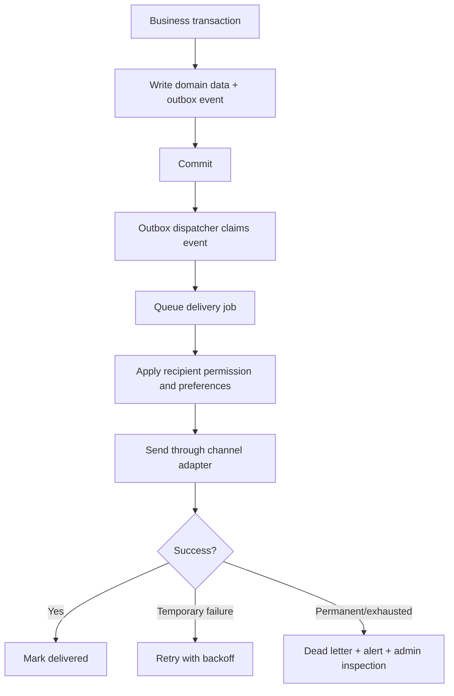

# سند جامع رودمپ طراحی و ساخت پلتفرم CRM سازمانی، مدیریت مشتری و عملیات کارکنان

**نسخه سند:** 1.0  
**تاریخ تدوین:** ۲۴ اکتبر ۲۰۲۶  
**وضعیت:** طرح مبنا برای محصول جدید؛ هنوز ممیزی مخزن یا محیط اجرایی موجود انجام نشده است.  
**دامنه:** وب، پنل کارکنان، CRM مشتریان، مدیریت کار و پروژه، پورتال مشتری، اپ موبایل iOS/Android، API، امنیت، عملیات و مسیر توسعه آتی.

---

## 0. خلاصه تصمیم‌های اجرایی

هدف ساخت یک «محیط کاری یکپارچه» است؛ نه صرفاً یک CRM فروش و نه فقط یک Jira دیگر. پلتفرم باید بتواند ارتباط با مشتری، پیگیری فرصت‌ها و درخواست‌ها، مدیریت وظایف و پروژه‌ها، همکاری داخلی، مستندات، اعلان‌ها، گزارش‌ها و تاریخچه قابل ممیزی را در یک مدل داده و تجربه کاربری منسجم به هم متصل کند.

### تصمیم پیشنهادی برای نسخه اول

1. **معماری آغازین: Modular Monolith** با مرزهای دامنه روشن؛ از ساخت ده‌ها microservice در شروع پرهیز شود.
2. **وب:** Next.js App Router + React + TypeScript، با رابط واکنش‌گرا و قابلیت نصب PWA در صورت نیاز.
3. **موبایل:** Expo + React Native + TypeScript؛ UI موبایل اختصاصی اما با قرارداد API، نوع‌ها، توکن‌های طراحی و قواعد اعتبارسنجی مشترک با وب.
4. **API و منطق بیزینس:** NestJS + TypeScript، مستندات OpenAPI و اعتبارسنجی سمت سرور.
5. **داده اصلی:** PostgreSQL؛ مدل رابطه‌ای، migration کنترل‌شده، ایندکس و سیاست‌های جداسازی داده.
6. **کارهای پس‌زمینه:** Redis + BullMQ برای jobهای عادی؛ outbox برای تحویل قابل اتکای رویدادهای دامنه. Temporal تنها زمانی اضافه شود که workflowهای طولانی، قابل بازیابی و چندسیستمی واقعاً لازم باشند.
7. **فایل‌ها:** ذخیره‌سازی شیءگرا سازگار با S3؛ متادیتا و مجوز فایل در PostgreSQL، نه در مسیر فایل.
8. **احراز هویت:** OIDC/OAuth2 با سرویس هویت معتبر در صورت نیاز سازمانی؛ session وب امن و ذخیره امن credential در موبایل. مجوزدهی کسب‌وکار در خود API اجرا شود.
9. **آزمون:** unit + integration + Playwright E2E + تست مجوزها + تست دسترس‌پذیری و تست بار برای مسیرهای بحرانی.
10. **استقرار:** محیط‌های dev/staging/production جدا، CI/CD، migration مرحله‌ای، پشتیبان‌گیری و آزمون واقعی بازیابی.

نسخه‌های پایدار و سازگار را هنگام شروع از مستندات رسمی انتخاب و در lockfile قفل کنید؛ از کپی‌کردن شماره نسخه از یک مقاله یا repository قدیمی خودداری شود. مستندات جاری Next.js از App Router و مستندات جاری Expo از ساخت اپ چندسکویی پشتیبانی می‌کنند؛ سازگاری نسخه‌ها باید هنگام bootstrap مجدداً کنترل شود.

### تصمیم مهم: چه چیزی را clone کنیم؟

**محصولات مرجع را برای یادگیری، بنچمارک UX و بررسی الگوریتم‌ها clone کنید؛ نه اینکه چند محصول کامل را بدون تصمیم معماری به هم بچسبانید.** برای محصول اصلی یک monorepo متعلق به شرکت بسازید. کد یک پروژه بیرونی تنها وقتی وارد محصول شود که نیاز، کیفیت، امنیت، وضعیت نگهداری و مجوز استفاده از همان نسخه بررسی و تأیید شده باشد. راهنما و فهرست ۵۰ منبع در بخش ۱۳ آمده است.

---

## 1. تعریف محصول و مرزها

### 1.1 گروه‌های کاربری

- **System Owner:** مدیریت تنظیمات سراسری، امنیت، اتصال‌ها و سیاست‌های نگهداری.
- **Organization Admin:** کاربران، تیم‌ها، نقش‌ها، گردش‌کارها و تنظیمات شرکت.
- **Manager / Team Lead:** ظرفیت تیم، تخصیص کار، تأییدها و گزارش‌ها.
- **Employee / Agent:** وظایف، پروژه‌ها، گفتگوها، فعالیت‌ها، زمان‌بندی و دانش سازمانی.
- **Sales / Account Manager:** سرنخ، شرکت، مخاطب، فرصت، فعالیت و پیگیری فروش.
- **Support Agent:** صندوق درخواست‌ها، SLA، دسته‌بندی، پاسخ و ارجاع.
- **Customer Portal User:** مشاهده و پیگیری صرفاً موارد متعلق به خود یا سازمان مشتری؛ نه محیط داخلی کارکنان.
- **Auditor / Read-only:** مشاهده مجاز و دریافت گزارش ممیزی بدون تغییر داده.
- **Service Account / Integration:** دسترسی محدود و قابل لغو برای اتصال‌های ماشینی.

یک شخص می‌تواند بیش از یک نقش داشته باشد، اما نقش‌ها باید به محدوده دسترسی واقعی متصل شوند. «مخفی کردن دکمه در فرانت‌اند» کنترل امنیتی محسوب نمی‌شود؛ هر عملیات باید در API مجوزدهی شود.

### 1.2 مرز CRM مشتری با مدیریت داخلی

دو فضای کاری متمایز اما مرتبط داشته باشید:

- **فضای داخلی:** کارمندها، تیم‌ها، پروژه‌ها، taskها، یادداشت داخلی، گزارش و مدیریت عملیات.
- **فضای مشتری:** پرونده شرکت/مخاطب، فرصت فروش، ارتباطات، تیکت‌ها و پورتال مشتری.
- **پل اتصال:** فعالیت مشتری می‌تواند یک task یا ticket داخلی بسازد؛ task داخلی می‌تواند به مشتری یا فرصت لینک شود؛ اما این اتصال به‌طور پیش‌فرض اطلاعات داخلی را برای مشتری افشا نمی‌کند.

برای هر comment، attachment، field و event یک سیاست نمایش/محدوده تعریف شود؛ تکیه بر یک فیلد `is_private` در همه‌جا کافی نیست، مگر اینکه به یک policy صریح و آزموده‌شده وصل باشد.

### 1.3 محدوده نسخه‌ها

**MVP واقعی:** ورود امن، مدیریت کاربران و تیم‌ها، CRM پایه، کارها و پروژه‌ها، comments، فایل، اعلان، جست‌وجو، گزارش‌های پایه، audit log، وب واکنش‌گرا، اپ موبایل برای کارهای اصلی و پورتال حداقلی مشتری.

**پس از MVP:** workflow builder، SLA پیشرفته، فرم‌ساز و custom fields، SSO/SCIM، تقویم پیشرفته، گزارش‌ساز، اتوماسیون‌های بین‌سیستمی، import/export گسترده، جست‌وجوی پیشرفته، offline محدود، AI assist تحت کنترل و marketplace اتصال‌ها.

**فعلاً نسازید:** microservices متعدد، موتور AI خودمختار با دسترسی گسترده، realtime برای همه جزئیات، فرانت‌اند کاملاً low-code، workflow builder عمومی شبیه BPMN و سیستم گزارش‌دهی بی‌نهایت پیچیده قبل از تثبیت نیازها.

---

## 2. نیازمندی‌های محصول و قابلیت‌ها

### 2.1 هسته CRM

- Companies / Accounts: شرکت، نوع، صنعت، مالک حساب، وضعیت، اطلاعات تماس و ارتباط با قراردادها.
- Contacts: مخاطبان، نقش، راه‌های ارتباطی و ارتباط با یک یا چند شرکت در صورت نیاز دامنه.
- Leads: منبع سرنخ، امتیاز، مالک، وضعیت و قواعد تبدیل به فرصت/مشتری.
- Deals / Opportunities: pipeline قابل تنظیم، ارزش احتمالی، احتمال، تاریخ هدف، فعالیت بعدی و دلیل برد/باخت.
- Timeline: تماس، جلسه، ایمیل ثبت‌شده، یادداشت، تغییر مالک، تغییر وضعیت و رویدادهای مرتبط.
- Tasks & reminders: پیگیری‌های زمان‌دار به مشتری/فرصت/تیکت متصل شوند.
- Duplicate detection: تشخیص احتمالی تکرار ایمیل، تلفن و شرکت با امکان ادغام کنترل‌شده و audit.
- Import/export: پیش‌نمایش، اعتبارسنجی، گزارش خطا، deduplication و jobهای قابل پیگیری.

### 2.2 مدیریت کارکنان و کار

- سازمان، تیم، عضویت تیم و ساختار گزارش‌دهی در حد نیاز واقعی.
- پروژه، برد، لیست، تقویم، فیلترهای ذخیره‌شده، milestone و وضعیت‌های قابل تنظیم.
- Task شامل عنوان، شرح، status، priority، assignee، reporter، watchers، تاریخ شروع/سررسید، برچسب، estimate، parent، وابستگی‌ها، فایل، comment و ارتباط‌های دامنه.
- Subtasks و وابستگی‌ها با اعتبارسنجی چرخه؛ یک task نباید مستقیم یا غیرمستقیم وابسته به خودش شود.
- گردش‌کار وضعیت با transitionهای مجاز؛ انتقال وضعیت دلخواه بدون rule ممنوع باشد.
- Activity log و status history برای فهمیدن اینکه چه کسی، چه چیزی را و چه زمانی عوض کرده است.
- مدیریت ظرفیت تیم، بار کاری، تقویم تعطیلات و تخصیص مجدد کنترل‌شده.
- Time tracking و timesheet را به‌صورت ماژول مستقل و مرحله‌ای توسعه دهید؛ زمان تخمینی را با زمان واقعی یکی نگیرید.

### 2.3 درخواست مشتری و پشتیبانی

- Ticket با شماره قابل خواندن، کانال، دسته، اولویت، وضعیت، مالک/تیم، requester، SLA، تاریخچه و پیوند به شرکت/مخاطب.
- اولویت‌دهی بر مبنای سیاست کسب‌وکار؛ SLA بر اساس تقویم کاری، ساعت کاری و تعطیلات تعریف‌شده محاسبه شود.
- پاسخ داخلی و پاسخ قابل مشاهده برای مشتری از نظر permission جدا باشد.
- ارجاع تیمی، escalation و بازگشایی ticket باید رخداد و audit ایجاد کند.
- نسخه اولیه کانال‌ها می‌تواند فرم وب و ثبت دستی باشد؛ اتصال ایمیل/چت/پیام‌رسان فاز بعدی است.

### 2.4 همکاری و دانش سازمانی

- notification center، mention، comment، subscriber/follower و digest.
- صفحات دانش/راهنما با مالک، بازبینی، وضعیت انتشار و مجوز مشاهده.
- پیوست فایل با بررسی نوع/اندازه، لینک دانلود زمان‌دار و ثبت دسترسی حساس.
- جست‌وجوی سراسری در محدوده مجاز کاربر؛ نتایج نیز باید policy را رعایت کنند.

### 2.5 مدیریت و گزارش

- داشبورد متفاوت بر اساس نقش و کارهای روز جاری، overdue، workload، pipeline، ticketها و KPIها.
- گزارش‌های پایه ابتدا از queryهای مشخص و ایندکس‌شده ساخته شوند؛ از اجرای queryهای آزاد و سنگین روی دیتابیس عملیاتی پرهیز کنید.
- هر عدد KPI تعریف، timezone، بازه زمانی و مالک مشخص داشته باشد.
- export گزارش دارای مجوز مستقل، ثبت audit و محدودیت حجم باشد.

---

## 3. معماری کلان

### 3.1 دیاگرام سیستم



**مرز مسئولیت‌ها:** وب و موبایل فقط لایه تجربه کاربر هستند. قوانین کسب‌وکار، مجوزها، اعتبارسنجی و تراکنش‌ها در API می‌مانند. worker کارهای زمان‌بر را اجرا می‌کند. DB منبع حقیقت است. cache یا search index جای DB اصلی نیست.

### 3.2 ساختار monorepo پیشنهادی

```text
company-workspace/
  apps/
    web/                 # Next.js: پنل کارکنان + پورتال مشتری با route group جدا
    mobile/              # Expo / React Native
    api/                 # NestJS API
    worker/              # worker پردازش job، اگر جداسازی اجرا ارزش داشته باشد
  packages/
    contracts/           # OpenAPI types/client و schemaهای مشترک
    domain-types/        # type/enumهای بی‌طرف، نه منطق حساس مجوزدهی
    design-tokens/       # semantic tokens و رنگ/فاصله/typography
    i18n/                # message catalog و قواعد locale
    config/              # تنظیمات مشترک lint/tsconfig/test
    test-utilities/      # fixtureها و helperها
  infra/
    docker/              # محیط توسعه محلی
    deploy/              # configهای محیط و deployment
    observability/       # dashboards و alert rules
  docs/
    adr/                 # Architectural Decision Records
    product/             # PRD، فلوها و سیاست‌های محصول
    api/                 # API conventions
    security/            # threat model و runbooks
    operations/          # backup/restore، incident و release
  .github/workflows/
```

این یک نقطه شروع است، نه الزام برای ساخت packageهای بی‌مصرف. هر package باید مصرف‌کننده مشخص داشته باشد. schemaهای API باید منبع قرارداد باشند و clientها به‌صورت کنترل‌شده تولید شوند.

### 3.3 ماژول‌های API

| ماژول | مسئولیت / مالکیت دامنه | نمونه داده |
|---|---|---|
| Identity & Access | عضویت، نشست، نقش و scope | User, Membership, Role, Permission |
| Organization | شرکت، تیم، ساختار | Organization, Team, TeamMember |
| CRM | شرکت/مخاطب/سرنخ/فرصت | Account, Contact, Lead, Deal |
| Work Management | پروژه و task | Project, Task, TaskDependency, Workflow |
| Support | درخواست و SLA | Ticket, TicketMessage, SLAClock |
| Activity | timeline و تاریخچه دامنه | Activity, StatusHistory |
| Collaboration | comment، mention، follower | Comment, Mention, Watcher |
| Files | متادیتا و دسترسی فایل | Attachment, FileAccessEvent |
| Notifications | اعلان و ترجیحات | Notification, DeliveryAttempt |
| Automation | ruleها و اجرای workflow | AutomationRule, AutomationRun |
| Search | جست‌وجوی مجاز | SearchDocument یا index adapter |
| Reporting | KPIها و export | SavedReport, ReportRun |
| Audit | رویدادهای حساس و تغییرات | AuditEvent |
| Integrations | اتصال‌های بیرونی | Integration, CredentialRef, WebhookEndpoint |

هر ماژول API داخلی مشخص داشته باشد. ماژول‌ها مستقیماً در جدول‌های یکدیگر دستکاری بی‌قاعده نکنند؛ عملیات cross-module از service/application layer یا domain event انجام شود. در ابتدای کار لازم نیست هر ماژول سرویس مستقل داشته باشد.

### 3.4 معماری داده

اصول پایه:

- شناسه داخلی پایدار (UUID/UUIDv7 یا معادل معتبر)؛ شناسه قابل نمایش مثل `TKT-1042` از آن جدا باشد.
- زمان‌ها در DB به UTC ذخیره شوند؛ timezone کاربر/سازمان برای نمایش و محاسبه تقویم کاری نگهداری شود.
- پول با عدد اعشاری شناور ذخیره نشود؛ در صورت وجود مبلغ از integer minor unit یا numeric با ارز مشخص استفاده شود.
- حذف منطقی فقط وقتی لازم است؛ در غیر این صورت سیاست retention و حذف واقعی روشن باشد.
- version/`updated_at` و کنترل concurrency در فرم‌های ویرایش حیاتی لحاظ شود.
- تمام روابط و queryها scope سازمانی و permission را رعایت کنند.
- برای گزارش‌های سنگین، view/materialized view یا read model بسازید؛ منبع اصلی دامنه را با KPIهای cache شده جایگزین نکنید.

#### مدل مفهومی حداقلی



این نمودار صرفاً ER مفهومی است؛ مدل نهایی باید براساس policy واقعی، cardinality، lifecycle و نیازهای گزارش‌گیری تکمیل شود.

### 3.5 Tenant و جداسازی اطلاعات

حتی برای نصب تک‌شرکتی، ستون/مفهوم organization و scope دسترسی را از ابتدا درست بسازید تا بعداً بخش‌بندی داده به بازنویسی کامل نیاز نداشته باشد.

- تمام entityهای سازمانی دارای `organization_id` باشند، مگر اینکه دلیل مستند برای global بودن وجود داشته باشد.
- context سازمان از عضویت معتبر کاربر تعیین شود؛ به `organization_id` ارسالی از کلاینت اعتماد نکنید.
- تمام queryهای repository یک راه استاندارد برای اعمال scope داشته باشند.
- برای سطح دفاعی بیشتر، PostgreSQL Row-Level Security قابل ارزیابی است؛ اما فقط وقتی transaction context، connection pooling، background worker و تست‌های cross-tenant به‌درستی طراحی شده‌اند. RLS جای مجوزدهی کاربردی و تست امنیتی را نمی‌گیرد.
- تست منفی باید ثابت کند کاربر سازمان A با دست‌کاری ID نمی‌تواند داده سازمان B را بخواند، و کارمند نمی‌تواند داده خصوصی مشتری یا یادداشت داخلی را به پورتال منتقل کند.

---

## 4. الگوریتم‌ها و قواعد بیزینس حیاتی

### 4.1 الگوریتم مجوزدهی (RBAC + scope/policy)

نقش به‌تنهایی کافی نیست. تصمیم مجوز باید بر اساس principal، action، resource، organization/team/project scope و ویژگی حساس resource گرفته شود.

```text
authorize(user, action, resource, context):
  1. هویت و نشست را اعتبارسنجی کن.
  2. عضویت فعال کاربر در سازمان resource را از منبع معتبر پیدا کن.
  3. نقش پایه و policyهای scope را جمع کن.
  4. policy مربوط به مالکیت، تیم، پروژه، نوع رکورد و سطح visibility را ارزیابی کن.
  5. اگر هر شرط لازم برقرار نبود، deny-by-default.
  6. برای عمل حساس، نتیجه و دلیل قابل ممیزی ثبت شود؛ اطلاعات محرمانه در log نوشته نشود.
  7. سپس command دامنه اجرا شود؛ فرانت‌اند فقط نتیجه را منعکس کند.
```

**معیار پذیرش:** پوشش تست مجوز برای هر endpoint، تست IDOR، تست دسترسی از طریق export/search/attachment/websocket و آزمون downgrade پس از لغو نقش یا عضویت.

### 4.2 الگوریتم تغییر وضعیت Task

هر workflow مجموعه‌ای از وضعیت‌ها و transitionهای مجاز دارد. status مستقیماً از request ذخیره نشود؛ command `transitionTask` اجرا شود.

```text
transitionTask(taskId, targetState, actor, expectedVersion):
  task = load task + organization scope
  assert authorize(actor, "task.transition", task)
  assert task.version == expectedVersion  # جلوگیری از overwrite خاموش
  rule = workflow.transition(task.state, targetState)
  assert rule exists
  validate required fields / approver / completion conditions
  update task state, version, updated_at
  append StatusHistory and AuditEvent
  write DomainEvent to transactional outbox
  commit transaction
  asynchronously notify watchers / recalc summaries
```

- تکمیل task می‌تواند فیلدهای اجباری داشته باشد.
- reopen باید transition روشن و audit داشته باشد.
- تغییر وضعیت توسط job یا integration همان policy را دور نزند.
- event و update باید با Transactional Outbox هماهنگ باشند؛ نباید DB commit شود اما اعلان یا integration بدون راه بازیابی گم شود.

### 4.3 وابستگی و جلوگیری از چرخه

برای dependency نوع `A blocked by B`، هنگام ایجاد لینک بررسی شود که با اضافه‌شدن یال جدید چرخه ایجاد نمی‌شود. در حجم ابتدایی می‌توان traversal گراف در transaction را به‌کار برد؛ با افزایش حجم، الگوریتم و قفل‌گذاری لازم را براساس workload بهینه کنید. در صورت نیاز، task نباید پیش از پایان dependencyهای blocking وارد وضعیت مشخصی شود؛ این rule در workflow تعریف شود و فقط در UI enforce نشود.

### 4.4 تخصیص کار و ظرفیت تیم

نسخه نخست فقط تخصیص دستی + نمایش ظرفیت و هشدار overload داشته باشد. فرمول ساده پیشنهادی برای نمایش بار کاری:

`load(user, range) = sum(remaining_estimate(task))` برای taskهای فعال در بازه؛ این عدد باید از estimateهای موجود محاسبه شود و به‌عنوان پیش‌بینی قطعی زمان معرفی نشود.

بعداً می‌توان تخصیص نیمه‌خودکار با ورودی‌های مهارت، ظرفیت، اولویت، due date، timezone و وابستگی را اضافه کرد؛ تصمیم نهایی و override انسانی باید حفظ شود. AI نباید بی‌اجازه مالک task یا موعد را تغییر دهد.

### 4.5 زمان‌بندی و SLA تیکت

SLA فقط `created_at + N hours` نیست. مدل لازم:

- تقویم کاری سازمان و تیم، timezone و تعطیلات.
- هدف پاسخ اول و هدف resolution که ممکن است متفاوت باشند.
- قوانین توقف/ادامه ساعت SLA (مثلاً انتظار از مشتری)، با تغییرات تاریخچه‌دار.
- سطح اولویت، ساعت شروع، pause/resume، escalation و سیاست بازگشایی.
- jobها idempotent باشند؛ اجرای دوباره نباید پیام یا escalation تکراری تولید کند.
- برای محاسبه، تابع `businessTimeBetween(start, end, calendar)` بسازید و با عبور از نیمه‌شب، تعطیلات، DST و timezoneهای متفاوت تست کنید.

### 4.6 Deduplication در CRM

1. ورودی را normalize کنید: ایمیل lowercase، شماره تلفن در قالب canonical با کشور در صورت امکان، نام شرکت با normalization محتاطانه.
2. match قطعی (مثل شناسه قانونی یا ایمیل یکتا در محدوده درست) را از match احتمالی جدا کنید.
3. برای match احتمالی پیشنهاد نمایش دهید؛ به‌صورت خودکار دو account یا contact را بدون تأیید و گزارش تغییر ادغام نکنید.
4. merge باید قابل audit باشد، ارجاع‌های رکوردهای وابسته را منتقل کند، داده‌های متناقض را طبق سیاست حل کند و امکان rollback/اصلاح مدیریتی داشته باشد.
5. محدودیت unique را در DB نیز اعمال کنید، اما تنها پس از روشن‌شدن scope یکتایی و سیاست داده‌های null/duplicate.

### 4.7 جست‌وجو

- MVP: PostgreSQL full-text/trigram و فیلترهای دقیق در محدوده مجاز.
- query parser با whitelist فیلدها و پارامترهای bindشده؛ رشته user هرگز به‌صورت SQL خام ترکیب نشود.
- نتایج هر نوع رکورد با policy همان resource فیلتر شود؛ search نباید راه دور زدن permission باشد.
- اگر نیازهای relevance، typo tolerance، حجم یا چندمنبعی فراتر رفت، موتور جست‌وجو جدا اضافه شود؛ index باید eventually consistent فرض شود.

### 4.8 اعلان‌ها و idempotency

- هر event دامنه شناسه یکتا داشته باشد.
- delivery key از event + recipient + channel + template version ساخته شود تا retry باعث ارسال تکراری نشود.
- ترجیحات اعلان (in-app/email/push/digest)، quiet hours و timezone را رعایت کنید.
- ثبت attempt، نتیجه provider، retry با backoff و dead-letter queue داشته باشید.
- متن اعلان از داده‌های حساس بیشتر از نیاز استفاده نکند؛ لینک از permission check عبور کند.

### 4.9 فایل‌ها

1. API یک upload intent با اندازه، MIME مجاز، resource مقصد و مجوز ایجاد کند.
2. کلاینت فایل را به مسیر امن/S3-compatible منتقل کند؛ نام فایل واقعی منبع اعتماد نیست.
3. وضعیت `pending_scan` تا بررسی نوع واقعی/بدافزار در صورت نیاز باقی بماند.
4. فقط فایل تأییدشده به‌عنوان attachment فعال شود.
5. لینک دانلود کوتاه‌عمر تولید شود و در زمان دسترسی، مالکیت و permission دوباره بررسی شود.
6. فایل حذف‌شده یا resource لغوشده باید طبق سیاست retention از دسترس خارج شود.

### 4.10 Automation / workflow

هر rule از trigger، شرط، action، scope، نسخه، owner، محدودیت اجرا، حالت خاموش/روشن و تاریخچه تشکیل شود. از اجرای زنجیره‌ای بی‌نهایت جلوگیری کنید: correlation ID، max hops، cooldown، rate limit و idempotency لازم است. در فاز اول تعداد trigger/action محدود و واضح باشد؛ کدنویسی یک BPMN/automation builder عمومی قبل از نیازسنجی توصیه نمی‌شود.

---

## 5. فلوچارت‌های اصلی محصول

### 5.1 مسیر ورود و انتخاب فضای کاری



### 5.2 جریان مدیریت وظیفه



### 5.3 جریان مشتری تا پیگیری داخلی



### 5.4 جریان اعلان قابل اتکا



---

## 6. IA، UI/UX و سیستم طراحی

### 6.1 اصول طراحی

- رابط باید برای انجام کار سریع باشد، نه نمایش بیشترین تعداد widget.
- کارهای پرتکرار با keyboard shortcut در وب و quick action در موبایل در دسترس باشند.
- فهرست‌ها با search، filter، sort، saved view، bulk action و empty state معنادار طراحی شوند.
- نمایش داده‌های مالی/فروش و وظایف باید تراکم قابل تنظیم داشته باشد؛ حالت compact برای کاربران پرتجربه و حالت آرام‌تر برای کاربران تازه‌کار.
- برای کارهای حساس تأیید متناسب لازم است؛ برای کارهای برگشت‌پذیر، undo بهتر از modal تکراری است.
- رنگ تنها نشانه status نباشد؛ متن، آیکون/شکل و دسترس‌پذیری هم لازم است.
- طراحی RTL/LTR، localization و تاریخ/عدد محلی از ابتدای token و component system لحاظ شود.
- پورتال مشتری از نظر navigation، متن و سطح جزئیات ساده‌تر از ابزار داخلی باشد.

### 6.2 نقشه ناوبری وب

```text
Workspace switcher
├── Overview
│   ├── My day / My work
│   ├── Team dashboard
│   └── KPI & alerts (permission-gated)
├── Work
│   ├── My tasks
│   ├── Projects
│   │   ├── Board
│   │   ├── List / Table
│   │   ├── Calendar / Timeline
│   │   └── Project details / Activity
│   ├── All tasks / Saved views
│   └── Approvals / Inbox
├── Customers
│   ├── Leads
│   ├── Accounts / Companies
│   ├── Contacts
│   ├── Deals / Pipelines
│   └── Customer 360 / Timeline
├── Support
│   ├── Team inbox
│   ├── My tickets
│   ├── SLA / Escalations
│   └── Help center / Knowledge
├── Collaboration
│   ├── Notifications
│   ├── Mentions
│   └── Knowledge base
├── Reports
│   ├── Workload / overdue
│   ├── CRM funnel
│   ├── Support SLA
│   └── Exports
└── Settings (permission-gated)
    ├── People / teams / roles
    ├── Workflows / custom fields
    ├── Notifications / integrations
    ├── Security / audit
    └── Organization / retention
```

### 6.3 الگوی صفحات کلیدی

**Dashboard:** «کار بعدی» در بالا، کارت‌های KPI قابل توضیح، overdue و فعالیت اخیر؛ امکان شخصی‌سازی محدود و کنترل‌شده.

**Task board:** ستون‌های workflow، drag-and-drop فقط برای transition مجاز، optimistic update با rollback، فیلترهای حفظ‌شونده و امکان استفاده بدون drag با منو/صفحه‌کلید.

**Task detail:** در وب به‌صورت side panel قابل لینک مستقیم یا صفحه مستقل؛ عنوان و وضعیت، مالک/تاریخ، شرح، وابستگی، activity/comments و attachments. تغییرات هم‌زمان توسط کاربران باید با conflict واضح مدیریت شوند.

**Customer 360:** خلاصه شرکت/مخاطب، مالک و وضعیت، فرصت‌ها، taskها، ticketها و timeline یکپارچه؛ هر بخش فقط داده‌ای را نشان دهد که کاربر مجاز به مشاهده‌اش است.

**Customer portal:** درخواست جدید، فهرست درخواست‌های خود/سازمان مجاز، وضعیت و پیام‌های قابل مشاهده، فایل‌های مجاز، اعلان ترجیحی و امکان دسترسی‌پذیر برای کاربران غیرتخصصی.

**Mobile My Work:** امروز/سررسید گذشته، taskها و ticketهای تخصیص‌یافته، اعلان، جست‌وجوی سریع، ایجاد task/ticket، کامنت و تغییر وضعیت. قابلیت‌های حجیم مدیریتی می‌توانند ابتدا فقط روی وب باشند.

### 6.4 Design system و اجزای اجباری

- semantic tokens: `surface`, `text`, `muted`, `border`, `brand`, `success`, `warning`, `danger`, `focus`؛ بدون hard-code رنگ در هر صفحه.
- typography scale، spacing scale، radius، shadow، breakpoints و motion tokens.
- Button، Input، Select، DatePicker، Combobox، Dialog، Drawer، Tooltip، Popover، Toast، Tabs، Breadcrumbs.
- DataTable: sorting، filtering، selection، pagination، column visibility، skeleton، empty/error state.
- KanbanCard، StatusBadge، PriorityIndicator، AvatarStack، ActivityTimeline، CommentComposer، FileUpload, UserPicker, CustomerPicker.
- permission-aware action menu و stateهای loading/disabled/error.
- skeletonهای متناسب با layout، empty state دارای اقدام بعدی و error state قابل بازیابی.
- RTL mirror با قواعد هدفمند؛ آیکون‌های معنایی مثل play/arrow نباید کورکورانه mirror شوند.
- کامپوننت‌های وب و موبایل می‌توانند جدا باشند؛ رفتار، token و الگوی محتوا باید هماهنگ بمانند.

### 6.5 دسترس‌پذیری و UX quality gate

- هدف: WCAG 2.2 AA برای مسیرهای مهم تا حد امکان قابل آزمون.
- keyboard navigation، focus order، focus visible و focus trap در dialog.
- label واقعی برای input، پیام خطا مرتبط، کنتراست، screen-reader semantics و احترام به reduced motion.
- هر عملیات drag باید راه جایگزین داشته باشد.
- تست در عرض‌های موبایل، تبلت، لپ‌تاپ و حالت زوم.
- فرم‌ها خطا را کنار فیلد و به‌صورت summary نمایش دهند و ورودی معتبر کاربر در خطا از بین نرود.
- هر صفحه با stateهای loading, empty, no permission, partial failure, offline و success طراحی شود.

---

## 7. وب و اپ موبایل

### 7.1 وب

- Next.js App Router برای routeها و layoutها؛ مرزبندی route groupهای internal و portal.
- Server Components برای بخش‌های مناسب read-heavy، Client Components فقط برای interaction لازم.
- صفحه‌های داده‌محور باید pagination/filter را در URL قابل اشتراک نگه دارند.
- API server-side و client-side قرارداد واحد داشته باشد؛ secret هرگز به bundle مرورگر نرود.
- PWA می‌تواند برای نصب‌پذیری و notificationهای پشتیبانی‌شده استفاده شود، اما جای اپ native را در همه قابلیت‌ها نمی‌گیرد.
- کَشینگ با سیاست explicit برای داده خصوصی؛ پاسخ‌های CRM/کاربر به‌صورت تصادفی shared cache نشوند.

### 7.2 موبایل

- Expo/React Native؛ نسخه Expo با نسخه React Native مورد پشتیبانی هم‌تراز شود.
- React Navigation/Expo Router براساس الگوی رسمی منتخب تیم؛ navigation state در مسیر deep link قابل بازسازی باشد.
- secure storage برای refresh/session credentials؛ AsyncStorage عمومی محل نگهداری secret نیست.
- push notification فقط سیگنال شروع است؛ هنگام بازکردن اپ مجدداً داده و permission از API بررسی شود.
- offline محدود در نسخه اول: خواندن موارد اخیر و نگهداری draft. sync دوطرفه پیچیده برای همه داده‌ها تا زمان تعریف conflict policy ساخته نشود.
- اگر sync آفلاین نیاز شد: هر mutation دارای `client_operation_id`, base version، timestamp و وضعیت queue باشد. سرور مرجع نهایی است؛ conflict باید به‌صورت قابل فهم حل یا به کاربر ارجاع شود.
- cache روی دستگاه با logout، revoke، حذف کاربر یا تغییر دسترسی پاک/بی‌اعتبار شود.
- crash reporting و crash-free sessions با رعایت حریم خصوصی.

### 7.3 تقسیم قابلیت موبایل در MVP

| قابلیت | MVP موبایل؟ | توضیح |
|---|---|---|
| ورود، انتخاب workspace، MFA در صورت نیاز | بله | مسیر امنیتی باید کامل باشد |
| My Work و task detail | بله | قابلیت پرتکرار |
| تغییر وضعیت، کامنت، تخصیص پایه | بله | با permission سمت API |
| ایجاد درخواست پشتیبانی و پیوست | بله | محدودیت حجم و امن‌سازی فایل |
| اعلان و deep link | بله | مجوزها مجدداً بررسی شوند |
| CRM record read + follow-up | بله/محدود | براساس نیاز تیم فروش |
| سازنده workflow، گزارش‌ساز پیچیده | خیر | ابتدا وب |
| bulk import/export و تنظیمات سراسری | خیر | ابتدا وب و نقش مدیر |
| full offline sync | خیر/فاز بعد | پس از طراحی conflict rules |

---

## 8. API، قراردادها و الگوی پیاده‌سازی

### 8.1 قرارداد API

- REST/JSON با نسخه‌گذاری زمانی که تغییر ناسازگار لازم است؛ قرارداد OpenAPI قابل تولید و بازبینی باشد.
- پاسخ خطا ساختار ثابت داشته باشد: `code`, `message`, `requestId`, `fieldErrors`؛ stack trace یا داده حساس به کلاینت ارسال نشود.
- برای لیست‌ها pagination استاندارد (cursor برای داده‌های بزرگ/تغییرپذیر)، sort/filter مجاز و محدودیت page size تعریف شود.
- endpoint از نوع `PATCH /tasks/:id` نباید اجازه تغییر همه فیلدها را بی‌قید بدهد؛ commandهای معنی‌دار برای transition، assign، merge و approve مناسب‌ترند.
- Idempotency key برای عملیات حساس یا درخواست‌هایی که احتمال retry دارند تعریف شود.
- optimistic concurrency با `version` یا `ETag/If-Match` برای جلوگیری از lost update.
- برای webhook خروجی: امضای پیام، timestamp، retry policy، replay protection و delivery log.

### 8.2 نمونه endpointهای منطقی

```text
GET    /v1/me
GET    /v1/workspaces
GET    /v1/tasks?assignee=me&status=open&cursor=...
POST   /v1/tasks
GET    /v1/tasks/:id
POST   /v1/tasks/:id/transition
POST   /v1/tasks/:id/assign
POST   /v1/tasks/:id/comments
GET    /v1/projects/:id/tasks
GET    /v1/crm/accounts?query=...
POST   /v1/crm/leads
POST   /v1/crm/leads/:id/convert
GET    /v1/crm/accounts/:id/timeline
POST   /v1/tickets
POST   /v1/tickets/:id/reply
POST   /v1/tickets/:id/escalate
GET    /v1/notifications
POST   /v1/notifications/:id/read
POST   /v1/files/upload-intents
GET    /v1/audit-events?resourceType=task&resourceId=...
```

این فهرست قرارداد نهایی نیست. اسم و shape هر endpoint باید با OpenAPI، policy و commandهای دامنه نهایی شود.

### 8.3 ساختار ماژول در NestJS

```text
src/modules/tasks/
  domain/              # entity/value object/policy/domain event
  application/         # commands, queries, use cases
  infrastructure/      # repository, db adapter, queue adapter
  presentation/        # controller, DTO, mapping
  tasks.module.ts
```

این لایه‌بندی باید عملی بماند؛ کلاس‌های اضافی فقط برای رعایت اصطلاحات معماری نسازید. Controller ورودی را validate می‌کند، use case مجوز و business rules را اجرا می‌کند و repository مرز ذخیره‌سازی را مدیریت می‌کند.

---

## 9. امنیت، حریم خصوصی و قابلیت اتکا

### 9.1 خط پایه امنیتی

- threat model برای data leakage، IDOR/BOLA، privilege escalation، session theft، attachment exposure، injection، webhook replay، spam و abuse.
- OAuth2/OIDC استاندارد؛ MFA/step-up برای اقدام حساس؛ session rotation و revoke.
- cookie وب: `HttpOnly`, `Secure`, `SameSite` متناسب؛ CSRF controls براساس معماری احراز هویت.
- validate و normalize ورودی سمت سرور؛ ORM جای authorization را نمی‌گیرد.
- rate limit و abuse controls روی login، search، invite، export، upload، webhook و endpointهای عمومی.
- secrets در secret manager / environment امن؛ در لاگ، client error، analytics و issue tracker قرار نگیرند.
- CSP و security headers؛ dependency scanning، secret scanning، SAST و بررسی license.
- upload validation، محدودیت اندازه و تعداد، malware scan در صورت نیاز، و عدم ارائه مسیر فایل مستقیم.
- audit immutable یا مقاوم در برابر دستکاری برای تغییرات حساس؛ audit نباید خود شامل رمز، token یا محتوای خصوصی بیش از نیاز باشد.
- سیاست retention، export و deletion مستند؛ اگر اطلاعات افراد اتحادیه اروپا پردازش شود، الزامات مرتبط GDPR، قرارداد پردازش، دسترسی/حذف و data residency با مشاور مسئول بررسی شود.
- اجرای تست امنیتی روی تمام مسیرهای وب، موبایل، API، export، search، background worker و اتصال‌ها.

### 9.2 سیاست‌های داده مشتری و کارکنان

- کمینه‌سازی داده: فقط اطلاعات موردنیاز کسب‌وکار جمع‌آوری شود.
- تفکیک data visibility: internal-only، customer-visible، admin-only و confidential باید در مدل دامنه صریح باشند.
- logهای عملیاتی نباید متن کامل ticket/comment یا PII را بی‌دلیل تکرار کنند.
- analytics فقط با داده کمینه و سیاست retention روشن.
- export/download ممکن است bulk disclosure باشد؛ مجوز جدا و audit لازم دارد.
- حساب غیرفعال، کارمند خارج‌شده و customer portal باید فرآیند revoke و انتقال مالکیت داشته باشند.

### 9.3 کیفیت و عملیات

- health/readiness checks؛ healthcheck نباید secret یا جزئیات زیرساخت را افشا کند.
- structured logging با request/correlation ID.
- traces برای مسیر request → DB → queue → provider.
- متریک‌های latency، error rate، queue lag، job failures، database saturation، push/email delivery و login anomalies.
- runbook برای outage دیتابیس، صف، سرویس ایمیل، push و storage.
- backup زمان‌بندی‌شده به محل جدا از سرور اصلی؛ restore drill واقعی و مستند.
- migrationها backward-compatible طراحی شوند؛ از deploy هم‌زمانی که نسخه قبلی برنامه را می‌شکند پرهیز شود.
- feature flag برای rolloutهای پرریسک؛ قابلیت خاموش‌کردن سریع integration یا automation.

### 9.4 هدف‌های کیفیت برای انتشار اولیه

اهداف پیشنهادی که باید براساس واقعیت زیرساخت تنظیم شوند:

- endpointهای معمولی خواندن در بار هدف، p95 حدود ۴۰۰ میلی‌ثانیه یا بهتر؛ queryهای گزارش جداگانه budget داشته باشند.
- مسیرهای اصلی کاربر در E2E سبز؛ هیچ defect بحرانی/شدید شناخته‌شده در امنیت یا data isolation.
- پوشش کد به‌تنهایی معیار کیفیت نیست؛ use caseهای حساس، مجوزها و state transitionها باید پوشش تستی داشته باشند.
- مانیتورینگ برای API، DB، jobها، storage و notification delivery فعال باشد.
- restore backup در staging به‌صورت عملی آزموده شده باشد.

---

## 10. تست و کنترل کیفیت

### 10.1 هرم تست

1. **Unit:** domain rules، workflow transitions، normalization، SLA calendar، deduplication و permission policies.
2. **Integration:** PostgreSQL واقعی/سازگار با production، migrationها، transactionها، outbox، queue و storage adapter.
3. **Contract:** OpenAPI، schema compatibility، consumer/provider contract بین وب/موبایل/API.
4. **E2E:** login، task create/edit/transition، CRM lead→deal، ticket و customer portal، upload/download، notifications.
5. **Security:** IDOR/BOLA، tenant isolation، cross-role، attachment permission، export, search, websocket و revoked sessions.
6. **Accessibility:** keyboard، focus، form labels/errors، contrast و مسیرهای اصلی.
7. **Performance:** فهرست‌های بزرگ، فیلترهای سنگین، dashboard، جست‌وجو، ارسال گروهی notification و queue backlog.
8. **Mobile:** deep links، push، secure storage، background/resume، offline draft و نسخه‌های OS هدف.

### 10.2 مجموعه سناریوهای اجباری E2E

- کارمند A در تیم 1 task را می‌بیند؛ کاربر خارج از scope با URL مستقیم به task دسترسی ندارد.
- task transition نامعتبر رد می‌شود و هیچ event/notification ثبت نمی‌شود.
- دو کاربر هم‌زمان task را تغییر می‌دهند؛ conflict به‌صورت مشخص برمی‌گردد و تغییر بی‌صدا گم نمی‌شود.
- کاربر تنها note داخلی می‌نویسد؛ مشتری آن را در پورتال، notification، export یا timeline نمی‌بیند.
- مشتری از سازمان دیگری با تغییر ID نمی‌تواند ticket/account را بخواند.
- retry job باعث ایجاد notification یا webhook تکراری نمی‌شود.
- merge دو contact تمام referenceهای مجاز را حفظ کرده و audit قابل بازبینی تولید می‌کند.
- revoke یک عضویت/نقش، دسترسی وب، موبایل و API را در محدوده مورد انتظار از بین می‌برد.
- فایل غیرمجاز یا بیش‌ازحد بزرگ رد می‌شود و لینک فایل برای کاربر غیرمجاز کار نمی‌کند.
- DST، تعطیلات و timezone در SLA/Reminder نتیجه درست می‌دهند.

### 10.3 CI gate

برای هر pull request: format/lint، typecheck، unit، integrationهای منتخب، build، migration validation، dependency/license scan، secret scan، و E2Eهای smoke. برای release: تست کامل، تست backup/restore یا تأیید تازه، بررسی changelog، rollback plan و smoke روی staging.

---

## 11. فازبندی و تسک‌های اجرایی

### فاز 0 — Discovery، تصمیم محصول و معماری

- [ ] مصاحبه کوتاه با مدیر، فروش، پشتیبانی، کارکنان و چند مشتری واقعی.
- [ ] فهرست جریان‌های فعلی Jira/Didar/Excel/email و نقاط شکست.
- [ ] تعریف واژگان مشترک: contact/account/lead/deal/task/ticket/project/workspace.
- [ ] اولویت‌بندی Must/Should/Could و تعیین موارد خارج از MVP.
- [ ] تدوین PRD، user journey، permission matrix و domain glossary.
- [ ] تصمیم تک‌سازمانی یا multi-organization، internal/customer portal و مدل SSO.
- [ ] threat model اولیه و data classification.
- [ ] ADR برای stack، authentication، ORM، queue، storage و deployment.

**خروجی قابل تحویل:** PRD تصویب‌شده، نمودار جریان‌ها، مدل مفهومی داده، ماتریس نقش/عملیات، ADRها و backlog رتبه‌بندی‌شده.

### فاز 1 — Bootstrap مخزن و زیرساخت توسعه

- [ ] monorepo و package manager با lockfile.
- [ ] apps/web، apps/mobile، apps/api و package contracts.
- [ ] Docker Compose توسعه برای PostgreSQL، Redis و storage محلی.
- [ ] env schema و validation؛ `.env.example` بدون secret.
- [ ] lint/format/typecheck/test/build و CI از روز اول.
- [ ] migration baseline، seed قابل تکرار و داده fake برای توسعه.
- [ ] structured logging و health endpoint.
- [ ] template برای ADR، PR، bug report و release checklist.

**معیار خروج:** توسعه‌دهنده جدید با دستورالعمل مستند محیط محلی را بالا می‌آورد؛ CI روی branch تازه سبز می‌شود.

### فاز 2 — هویت، سازمان، مجوز و audit

- [ ] ورود/خروج، reset/verification طبق سیاست شرکت و MFA/SSO در صورت نیاز.
- [ ] user، organization، membership، team و invite.
- [ ] نقش و permission catalog، scope enforcement در API.
- [ ] revoke نشست‌ها و نقش‌ها.
- [ ] audit برای ورودهای حساس، مدیریت عضویت و تغییر نقش.
- [ ] security testهای IDOR، cross-org و privilege escalation.

**معیار خروج:** همه endpointهای محافظت‌شده یک سیاست دسترسی آزموده‌شده دارند؛ هیچ مسیر فقط با مخفی‌کردن UI محافظت نشده است.

### فاز 3 — Design system و اسکلت UX

- [ ] توکن‌های طراحی و theme.
- [ ] app shell، navigation، workspace switcher و responsive breakpoints.
- [ ] فرم‌ها، dialog/drawer، toast، table، filter، empty/loading/error states.
- [ ] استاندارد RTL/LTR و locale.
- [ ] Storybook یا محیط نمایش componentها.
- [ ] تست accessibility برای componentهای پایه.
- [ ] prototype تعاملی ۵ مسیر: login، My Work، task detail، Customer 360 و customer ticket.

**معیار خروج:** صفحات اول با سیستم کامپوننت ساخته شده‌اند؛ componentهای تکراری و styleهای پراکنده کنترل شده‌اند.

### فاز 4 — Work management هسته‌ای

- [ ] project، workflow، task، assignment، watcher و comment.
- [ ] board/list/detail و فیلتر/جست‌وجو.
- [ ] status transition و version conflict.
- [ ] task dependency و جلوگیری از چرخه.
- [ ] activity history و audit.
- [ ] outbox + worker برای اعلان‌های اصلی.
- [ ] task E2E و permission test.

**معیار خروج:** کارمند می‌تواند یک کار را از ایجاد تا پایان، همراه تاریخچه و اعلان، روی وب انجام دهد.

### فاز 5 — CRM و Customer 360

- [ ] accounts، contacts، leads و deal pipeline.
- [ ] timeline فعالیت‌ها و next follow-up.
- [ ] normalization و duplicate suggestions.
- [ ] تبدیل lead به account/contact/deal به‌شکل اتمیک و idempotent.
- [ ] اتصال task به مشتری/فرصت.
- [ ] import آزمایشی با validation report و audit.
- [ ] dashboard فروش پایه و تست privacy.

**معیار خروج:** تیم CRM می‌تواند تعامل مشتری را ثبت و پیگیری کند و تغییر/تبدیل رکورد داده تکراری یا orphan ایجاد نمی‌کند.

### فاز 6 — Support و customer portal

- [ ] ticket، پیام، اولویت، دسته، مالک و team inbox.
- [ ] سیاست جداگانه internal note در برابر customer-visible reply.
- [ ] portal login و دسترسی محدود به درخواست‌های متعلق به مشتری.
- [ ] SLA پایه با calendar/timezone.
- [ ] escalation و reopen.
- [ ] پیوست امن و اعلان تغییر وضعیت.
- [ ] تست نشت داده با accountهای مختلف مشتری.

**معیار خروج:** مشتری وضعیت درخواست خود را ببیند، اما اطلاعات داخلی و داده مشتریان دیگر هرگز در API/جست‌وجو/اعلان/فایل افشا نشود.

### فاز 7 — موبایل

- [ ] ورود امن و انتخاب workspace.
- [ ] My Work، task detail، comment و transition.
- [ ] ticket list/create/reply در محدوده مجاز.
- [ ] push notification + deep links.
- [ ] cache محدود، draft آفلاین و پاکسازی cache پس از revoke/logout.
- [ ] crash reporting، accessibility و تست دستگاه‌های هدف.
- [ ] انتشار داخلی در channel آزمایشی و جمع‌آوری feedback.

**معیار خروج:** جریان‌های منتخب بدون وابستگی به وب قابل اجرا باشند؛ شکست شبکه یا push باعث ازدست‌رفتن داده یا عبور از مجوزها نشود.

### فاز 8 — گزارش، جست‌وجو و اتوماسیون کنترل‌شده

- [ ] overdue/workload و CRM funnel.
- [ ] saved views و جست‌وجوی cross-module مجاز.
- [ ] notification preferences و digest.
- [ ] چند rule کاربردی automation با preview، dry-run و kill switch.
- [ ] job dashboard، retry و dead-letter management.
- [ ] query budget، ایندکس و performance test.

**معیار خروج:** گزارش‌ها با تعریف KPI روشن هم‌خوان‌اند و automation قابل مشاهده، قابل خاموش‌کردن و idempotent است.

### فاز 9 — Hardening و آمادگی انتشار

- [ ] threat model و تست امنیتی نهایی.
- [ ] accessibility audit مسیرهای حیاتی.
- [ ] تست بار روی حجم داده مورد انتظار و ثبت baseline.
- [ ] backup/restore drill در محیط جدا.
- [ ] runbook، alert و on-call owner.
- [ ] تست migration از release قبلی و rollback strategy.
- [ ] privacy/retention policy، export/delete process و بررسی حقوقی مرتبط.
- [ ] UAT با نقش‌های واقعی و sign-off هر واحد.

**معیار خروج:** هیچ issue بحرانی باز، مسیر rollback مشخص، restore آزموده، KPI و لاگ‌های عملیاتی معتبر و مالک مشخص برای عملیات وجود دارد.

### فاز 10 — توسعه سازمانی و مقیاس

- [ ] SSO/SCIM/Directory sync در صورت نیاز.
- [ ] custom fields و form builder با محدودیت schema.
- [ ] workflow designer پیشرفته فقط براساس نیاز واقعی.
- [ ] data warehouse/analytics جدا در صورت نیاز به گزارش سنگین.
- [ ] search engine مستقل فقط پس از اثبات محدودیت PostgreSQL.
- [ ] split کردن worker یا domain service فقط وقتی load/ownership/deployment به‌طور مستند توجیه کند.
- [ ] AI assist در حالت read-only یا پیشنهاددهنده، با permission checks، audit و human approval.

---

## 12. Backlog به تفکیک اولویت

### P0 — بدون این موارد launch نکنید

- احراز هویت، نشست و revoke معتبر.
- server-side authorization و جلوگیری از IDOR/BOLA.
- schema و migration نسخه‌بندی‌شده.
- account/contacts یا ticket/task بر اساس دامنه واقعی شرکت.
- وضعیت‌های task معتبر، assignment و audit trail.
- تفکیک internal/customer-visible content.
- backup و restore آزموده.
- CI و تست‌های جریان اصلی.
- error handling، logging، monitoring و مدیریت secret.

### P1 — برای استفاده روزمره سازمان

- فیلترهای ذخیره‌شده، notification preferences، mention/comment.
- customer timeline و follow-up.
- جست‌وجوی مجاز و import/export کنترل‌شده.
- اپ موبایل برای My Work و پشتیبانی.
- گزارش overdue، workload، pipeline و SLA.
- UX حالت‌های خالی، خطا، loading و دسترس‌پذیری.

### P2 — پس از سنجش استفاده واقعی

- workflow builder پیشرفته، custom objects، marketplace integration.
- full offline sync، advanced analytics، AI assistant و تخصیص هوشمند.
- microservices، event streaming مستقل یا search cluster جدا، مگر اینکه telemetry نیاز آن را ثابت کند.

---

## 13. پنجاه مخزن مرجع پیشنهادی

**روش استفاده:** این ۵۰ مخزن فهرست مطالعه و benchmark هستند، نه ۵۰ وابستگی اجباری. برای هر منبع، README، معماری، تست، امنیت، مدل داده، سطح فعالیت و مجوز همان commit/tag را بررسی کنید. معمولاً فقط ساختارها و ایده‌ها را اقتباس می‌کنیم؛ clone مستقیم کد به محصول اصلی بدون بررسی license و وابستگی‌ها ممنوع است.

### A. CRM، مدیریت کار و Support — ۱۰ مخزن

1. [Twenty](https://github.com/twentyhq/twenty) — مدل CRM مدرن، account/contact/deal، custom data model و الگوی صفحه‌های CRM. بررسی مجوز نسخه جاری ضروری است.
2. [Plane](https://github.com/makeplane/plane) — issue/task tracker، board، cycle، module، view و roadmap؛ مرجع UX برای مدیریت کار.
3. [Chatwoot](https://github.com/chatwoot/chatwoot) — shared inbox و تجربه پشتیبانی مشتری، ticket/conversation و کانال‌های ارتباطی.
4. [EspoCRM](https://github.com/espocrm/espocrm) — CRM کلاسیک با workflowها و مدل‌های فروش؛ مرجع برای CRM سازمانی.
5. [Frappe CRM](https://github.com/frappe/crm) — pipeline و فعالیت‌های فروش؛ مطالعه ساختار مدل و جریان فروش.
6. [ERPNext](https://github.com/frappe/erpnext) — ارتباط CRM با ERP و فرایندهای تجاری؛ دامنه آن از نیاز MVP گسترده‌تر است.
7. [OpenProject](https://github.com/opf/openproject) — پروژه/portfolio، milestone، Gantt و مدیریت رسمی کار.
8. [Leantime](https://github.com/Leantime/leantime) — تسک و برنامه‌ریزی برای کاربران غیرتخصصی؛ توجه به شرایط مجوز و استثناها.
9. [Vikunja](https://github.com/go-vikunja/vikunja) — task manager، فهرست و تجربه مدیریت کار؛ مجوز نسخه مورد استفاده را بررسی کنید.
10. [Taiga](https://github.com/taigaio/taiga) — agile project management، sprint و workflowهای تیمی.

### B. وب و Design System — ۱۰ مخزن

11. [Next.js](https://github.com/vercel/next.js) — ساختار app، rendering و routeها؛ راهنمای رسمی App Router را نیز بخوانید.
12. [shadcn/ui](https://github.com/shadcn-ui/ui) — الگوی componentهای قابل مالکیت و design system وب؛ componentها را آگاهانه وارد پروژه کنید.
13. [Radix Primitives](https://github.com/radix-ui/primitives) — semantics و primitiveهای قابل دسترس برای dialog/popover/menu.
14. [TanStack Query](https://github.com/TanStack/query) — server-state، cache، invalidation و mutation lifecycle.
15. [TanStack Table](https://github.com/TanStack/table) — جدول‌های داده‌ای headless با sort/filter/selection.
16. [React Hook Form](https://github.com/react-hook-form/react-hook-form) — مدیریت فرم و performance.
17. [Zod](https://github.com/colinhacks/zod) — schema validation و type inference؛ اعتبارسنجی سمت سرور هم لازم است.
18. [dnd-kit](https://github.com/clauderic/dnd-kit) — تعامل drag-and-drop برای board؛ fallback دسترس‌پذیر فراموش نشود.
19. [FullCalendar](https://github.com/fullcalendar/fullcalendar) — تقویم و event interaction؛ مجوز و امکانات مورد نیاز را بررسی کنید.
20. [Storybook](https://github.com/storybookjs/storybook) — مستندسازی، بررسی بصری و تست componentها.

### C. API، دیتابیس، queue و monorepo — ۱۰ مخزن

21. [NestJS](https://github.com/nestjs/nest) — ماژول‌بندی API، guard، validation، queue و WebSocket.
22. [PostgreSQL](https://github.com/postgres/postgres) — منبع اصلی داده؛ مستندات رسمی SQL و Row-Level Security را مرجع قرار دهید.
23. [Prisma ORM](https://github.com/prisma/prisma) — schema، migration و type-safe DB access؛ محدودیت‌های queryها را ارزیابی کنید.
24. [Redis](https://github.com/redis/redis) — cache، limiter و queue backing؛ منبع حقیقت داده کسب‌وکار نباشد.
25. [BullMQ](https://github.com/taskforcesh/bullmq) — job queue، retry و workerهای پس‌زمینه.
26. [Temporal](https://github.com/temporalio/temporal) — الگوی durable workflow؛ گزینه‌ای برای فرایندهای طولانی، نه الزام MVP.
27. [Socket.IO](https://github.com/socketio/socket.io) — realtime event delivery؛ authorization و بازیابی پس از reconnect لازم است.
28. [Turborepo](https://github.com/vercel/turborepo) — pipeline ساخت و cache در monorepo.
29. [pnpm](https://github.com/pnpm/pnpm) — package manager و workspaceها.
30. [Orval](https://github.com/orval-labs/orval) — تولید client/type از OpenAPI؛ خروجی باید versioned و در CI کنترل شود.

### D. موبایل، تست و کیفیت — ۱۰ مخزن

31. [Expo](https://github.com/expo/expo) — ساخت و انتشار اپ React Native با ابزارهای اکوسیستم Expo.
32. [React Native Paper](https://github.com/callstack/react-native-paper) — componentهای Material برای موبایل؛ با design system محصول تطبیق داده شود.
33. [React Native Reanimated](https://github.com/software-mansion/react-native-reanimated) — انیمیشن‌های native-performance؛ فقط در جایی که UX را بهتر می‌کند.
34. [React Native Gesture Handler](https://github.com/software-mansion/react-native-gesture-handler) — تعامل gesture در موبایل.
35. [React Native MMKV](https://github.com/mrousavy/react-native-mmkv) — storage سریع محلی؛ به‌تنهایی secure secret vault نیست.
36. [Zustand](https://github.com/pmndrs/zustand) — state محلی سبک؛ server-state را بی‌دلیل با آن جایگزین نکنید.
37. [Playwright](https://github.com/microsoft/playwright) — E2E وب و سناریوهای حیاتی.
38. [Vitest](https://github.com/vitest-dev/vitest) — unit/integration test برای TypeScript.
39. [React Testing Library](https://github.com/testing-library/react-testing-library) — تست از دید کاربر، نه وابسته به جزئیات داخلی component.
40. [MSW](https://github.com/mswjs/msw) — mock شبکه در تست و توسعه؛ جای integration test واقعی DB را نمی‌گیرد.

### E. هویت، سیاست دسترسی، Observability و اتصال‌ها — ۱۰ مخزن

41. [Keycloak](https://github.com/keycloak/keycloak) — هویت، SSO و OIDC؛ گزینه بررسی برای سازمان‌ها.
42. [Casbin](https://github.com/casbin/casbin) — مدل‌های policy/RBAC/ABAC؛ فقط پس از مقایسه با نیازهای واقعی مجوز انتخاب شود.
43. [OpenFGA](https://github.com/openfga/openfga) — relationship-based authorization برای دامنه‌های پیچیده؛ احتمالاً برای MVP ضروری نیست.
44. [Cerbos](https://github.com/cerbos/cerbos) — policy-based authorization؛ هزینه عملیاتی و نیاز تیم را بررسی کنید.
45. [OpenTelemetry JS](https://github.com/open-telemetry/opentelemetry-js) — instrumentation و trace/metrics/log context.
46. [Grafana](https://github.com/grafana/grafana) — dashboard و مشاهده متریک‌ها.
47. [Sentry](https://github.com/getsentry/sentry) — خطا و performance monitoring؛ گزینه‌های self-hosted/تجاری و حریم خصوصی بررسی شوند.
48. [n8n](https://github.com/n8n-io/n8n) — مطالعه اتوماسیون و اتصال سرویس‌ها؛ مجوز آن source-available/محدودیت‌دار است و نباید خودکار «open source مجاز برای embed» فرض شود.
49. [Formbricks](https://github.com/formbricks/formbricks) — فرم و بازخورد محصول؛ برای جمع‌آوری feedback و survey مرجع است.
50. [Cal.com](https://github.com/calcom/cal.com) — scheduling و رزرو جلسه؛ مجوز و محدوده قابلیت‌های نسخه جاری بررسی شود.

### روش benchmark برای هر مخزن

برای هر مورد در یک سند ارزیابی ثبت شود:

- مسئله‌ای که حل می‌کند و بخش‌هایی که برای ما relevant هستند.
- زبان، framework، معماری و مدل داده.
- آخرین release/commit و تعداد issueهای مهم باز؛ آمار GitHub فقط نشانه اولیه است، نه تضمین کیفیت.
- تست‌ها، CI، security policy و راهنمای contribution.
- فایل `LICENSE` و license تمام dependencyها/assetها؛ محدودیت SaaS، تجاری، attribution و copyleft.
- دقیقاً چه چیزی قرار است اقتباس شود: ایده UX، API contract، الگوریتم، component یا کد.
- هزینه نگهداری و مالک داخلی آن پس از اقتباس.

**هشدار مجوز:** برای محصولات دارای AGPL/GPL، مجوزهای source-available یا پوشه‌های enterprise، بررسی حقوقی را قبل از ادغام کد انجام دهید. مشاهده GitHub یا داشتن امکان clone به‌معنای اجازه استفاده تجاری/بازتوزیع نیست.

---

## 14. پانزده Agent Skill پیشنهادی

این‌ها skillهای عملیاتی برای عامل‌های برنامه‌نویس هستند؛ بهتر است در مخزن خودتان به‌صورت دستورالعمل‌های کوچک، قابل تکرار و قابل ممیزی ذخیره شوند. هر skill باید `SKILL.md` با هدف، ورودی، مراحل، خروجی، چک‌لیست کیفیت و محدودیت دسترسی داشته باشد. می‌توانید الگوی ساختاری skillها را از [Anthropic Agent Skills](https://github.com/anthropics/skills) و [Agent Skills specification](https://agentskills.io/) مطالعه کنید؛ سازگاری دقیق با ابزار مورد استفاده را پیش از نصب تأیید کنید.

1. **product-discovery** — تبدیل مصاحبه و workflow جاری به PRD، user story، خارج از محدوده و acceptance criteria؛ خروجی: PRD و backlog.
2. **domain-modeling** — تعریف glossary، entity، state machine، invariants و domain event؛ خروجی: مدل داده مفهومی و ADR.
3. **architecture-adr** — پیشنهاد معماری و مقایسه گزینه‌ها با trade-off و هزینه عملیاتی؛ خروجی: ADR کوتاه و قابل رأی‌گیری.
4. **ui-ux-system** — ساخت user flow، information architecture، responsive states و design tokens؛ خروجی: wireframe checklist و component plan.
5. **accessibility-rtl-i18n** — بررسی keyboard، semantic HTML، contrast، RTL/LTR، ترجمه و timezone؛ خروجی: فهرست اصلاحات قابل آزمون.
6. **nestjs-module-builder** — افزودن use case به الگوی module/domain/application/infrastructure؛ خروجی: کد، تست و OpenAPI به‌روزشده.
7. **api-contract-review** — بررسی نام‌گذاری endpoint، DTO، error model، pagination، idempotency و breaking change؛ خروجی: contract checklist.
8. **database-migration-review** — طراحی migration ایمن، index، backfill و rollback/roll-forward؛ خروجی: migration plan و test cases.
9. **authorization-threat-model** — ساخت permission matrix و abuse cases؛ بررسی BOLA/IDOR، cross-org، export، search و file access؛ خروجی: تست منفی.
10. **crm-workflow-rules** — بررسی lead conversion، dedupe، ownership، timeline و pipeline transitions؛ خروجی: state transition و آزمون invariantها.
11. **task-workflow-sla** — اعتبارسنجی task dependencies، concurrency، calendar/timezone و SLA; خروجی: الگوریتم، تست مرزی و policy روشن.
12. **expo-mobile-engineering** — deep link، secure storage، notification، lifecycle، offline draft و crash handling؛ خروجی: implementation checklist و تست دستگاه.
13. **test-engineering** — طراحی unit/integration/contract/E2E/security matrix و جلوگیری از تست‌های brittle؛ خروجی: plan و suiteهای لازم.
14. **observability-sre** — metric، trace، log، SLO، alert و runbook بر پایه failure mode؛ خروجی: instrumentation و دستورالعمل incident.
15. **dependency-license-audit** — بررسی license و dependency graph، secrets، CVEها، منبع و سطح نگهداری؛ خروجی: گزارش ریسک و پیشنهاد جایگزین.

### ساختار هر Skill

```text
.agents/skills/<skill-name>/
  SKILL.md
  references/              # استانداردها و نمونه‌های قابل استناد
  templates/               # قالب خروجی تکرارپذیر
  scripts/                 # فقط ابزارهای امن و ضروری
```

### قواعد ایمنی برای Agentها

- Agent حق ندارد secret واقعی را بخواند یا در log/chat منتشر کند.
- دسترسی شبکه/نوشتن/انتشار باید حداقلی باشد؛ هیچ deploy یا push به production بدون اجازه انسانی صریح.
- هر تغییر schema یا permission باید تست منفی و migration plan داشته باشد.
- refactor بزرگ و feature جدید در یک PR قاطی نشوند.
- Agent باید uncertainty و فایل‌هایی را که بررسی نکرده اعلام کند؛ نباید ادعای «همه‌چیز audit شد» بدون evidence داشته باشد.
- خروجی هر skill: فایل‌های تغییرکرده، دستورات تست اجراشده، نتیجه واقعی، ریسک باقیمانده و معیار پذیرش.

---

## 15. مدیریت clone، اقتباس و نگهداری منابع

### 15.1 سیاست پیشنهادی

- مخزن اصلی محصول: private/company-controlled؛ منبع حقیقت توسعه.
- نمونه‌های مرجع: در یک فهرست `docs/references/repositories.md` ثبت شوند؛ cloneهای آفلاین فقط در فضای مطالعه جدا و بدون merge مستقیم.
- برای هر کد اقتباس‌شده: لینک upstream، commit/tag، مسیرهای کپی‌شده، license، attribution و تغییرات محلی ثبت شود.
- وابستگی‌ها نسخه‌بندی و lock شوند؛ branch بدون pin یا dependency شناور برای production ممنوع.
- botهای update روی PR اجرا شوند و تست‌ها قبل از merge بگذرند.
- اگر از یک محصول کامل fork می‌شود، ابتدا یک **decision gate** انجام دهید: آیا تغییر دادن fork از ساخت ماژول مستقل کم‌هزینه‌تر است؟ آیا معماری و license اجازه می‌دهد؟ هزینه upgrade و patch امنیتی چقدر است؟

### 15.2 گزینه‌های ساخت/اقتباس

| گزینه | زمانی مناسب است | ریسک اصلی |
|---|---|---|
| Greenfield + مطالعه منابع | وقتی UX/دامنه یکپارچه و محصول اختصاصی لازم است | زمان بیشتر برای رسیدن به feature parity |
| Fork یک CRM و توسعه روی آن | وقتی مدل فروش نزدیک است و سرعت عرضه اولویت دارد | محدودیت license/معماری و هزینه نگهداری fork |
| ترکیب چند محصول مستقل | فقط وقتی API و ownership روشن است | پراکندگی تجربه، هویت، data model و گزارش‌ها |
| استفاده از ابزار internal app در بخش مدیریتی | برای پنل‌های عملیاتی غیرهسته‌ای | تجربه کاربر دوگانه و محدودیت‌های محصول |

**پیشنهاد پیش‌فرض:** Greenfield با ماژول‌های واضح، استفاده از کتابخانه‌های مستقل و مطالعه ۵۰ منبع؛ ابزارهای آماده فقط برای قابلیت غیرهسته‌ای پس از بررسی امنیت/مجوز.

---

## 16. گزارش‌دهی، KPI و Definition of Done

### 16.1 KPIهای محصول

- زمان از ایجاد lead تا نخستین پیگیری.
- درصد leadهای بدون مالک یا بدون next action.
- تعداد/درصد taskهای overdue و زمان چرخه task.
- workload هر تیم با لحاظ estimateها و ظرفیت اعلام‌شده.
- زمان پاسخ اول و زمان resolution تیکت در ساعات کاری.
- درصد اعلان‌های موفق و مدت ماندن job در صف.
- adoption: کاربران فعال هفتگی به تفکیک نقش و تکمیل کار اصلی.
- خطاهای مجوز، درخواست‌های denied غیرعادی و رخدادهای security.
- crash-free sessions موبایل و latency صفحه‌های پرتکرار.

هر KPI باید owner، تعریف دقیق، timezone، روش جمع‌آوری و محدودیت تفسیر داشته باشد.

### 16.2 Definition of Done هر feature

- [ ] نیاز و acceptance criteria ثبت شده‌اند.
- [ ] flow و permission matrix به‌روز شده‌اند.
- [ ] schema/API و migrationها بازبینی شده‌اند.
- [ ] مجوز در API enforce شده، نه فقط UI.
- [ ] loading/empty/error/no-permission/partial-failure state وجود دارد.
- [ ] unit و integration test مناسب نوشته شده‌اند.
- [ ] E2E برای جریان کاربر یا تغییر دامنه حساس به‌روز شده است.
- [ ] logging/metrics برای نقاط failure ضروری است.
- [ ] ترجمه، RTL/LTR و accessibility بررسی شده‌اند.
- [ ] documentation، OpenAPI و changelog به‌روز شده‌اند.
- [ ] rollback/feature flag برای تغییر پرریسک مشخص است.
- [ ] license/security scanning و dependency review سبز است.

---

## 17. تصمیم‌های باز که باید در Discovery نهایی شوند

این موارد مانع تدوین نقشه نیستند، اما پیش از پیاده‌سازی باید بر مبنای واقعیت شرکت تصمیم قطعی بگیرند:

1. یک شرکت با چند تیم، یا سازمان‌های حقوقی/tenant مستقل؟
2. مشتری بیرونی فقط پورتال تیکت می‌خواهد یا پنل کامل CRM/سفارش/قرارداد هم لازم است؟
3. مهاجرت داده از کدام ابزارها، Excel، Didar، Jira، ایمیل یا سیستم داخلی قبلی انجام می‌شود؟
4. نیاز به ایمیل sync، تماس تلفنی، WhatsApp/Telegram یا پیام‌رسان داخلی از روز اول وجود دارد؟
5. SSO سازمانی، MFA اجباری، directory sync و سیاست device management لازم است؟
6. چه داده‌های شخصی/محرمانه پردازش می‌شوند و الزام قانونی/مکانی ذخیره‌سازی چیست؟
7. تعداد کاربران فعال، رکوردهای CRM، حجم فایل، نرخ notification و تعداد درخواست هم‌زمان چقدر است؟
8. زبان‌ها، تقویم‌ها، timezoneها، RTL/LTR و قواعد شماره/تاریخ مورد نیاز چیست؟
9. آیا اپ موبایل باید در حالت آفلاین کار کند یا My Work آنلاین کافی است؟
10. میزبان deployment، مسئول عملیات، بودجه زیرساخت و سطح پشتیبانی چیست؟

برای موارد نامشخص، MVP را با کمینه قابلیت برگشت‌پذیر بسازید و تصمیم را در ADR ثبت کنید، نه اینکه فرض پنهان در کد ایجاد شود.

---

## 18. منابع فنی و استانداردهای تکمیلی

- Next.js App Router: https://nextjs.org/docs/app
- Expo Documentation: https://docs.expo.dev/
- Expo SDK compatibility: https://docs.expo.dev/versions/latest/
- NestJS techniques (validation, queues, websockets, OpenAPI): https://docs.nestjs.com/techniques
- PostgreSQL Row Security: https://www.postgresql.org/docs/current/ddl-rowsecurity.html
- OWASP Application Security Verification Standard (ASVS): https://asvs.owasp.org/
- OWASP Top 10: https://owasp.org/www-project-top-ten/
- OpenTelemetry JavaScript: https://opentelemetry.io/docs/languages/js/
- Agent Skills repository: https://github.com/anthropics/skills
- Agent Skills specification: https://agentskills.io/

---

## 19. دستور آغاز پروژه برای تیم اجرایی یا کدنویسی Agent

این دستور را می‌توانید به‌عنوان brief اولیه به تیم یا coding agent بدهید:

> بر اساس این سند، ابتدا فقط فاز Discovery و Bootstrap را اجرا کن. قبل از نوشتن feature، مخزن را به‌صورت ساختاری ایجاد کن، ADRها و permission matrix را ثبت کن و تصمیم‌های stack/ORM/auth را با منابع جاری تأیید کن. سپس یک vertical slice کامل بساز: ورود کاربر → workspace → مشاهده My Work → ایجاد task → transition مجاز → audit/event → notification → تست E2E. تمام مجوزها باید سمت API enforce شوند. از ساخت microserviceهای متعدد، AI feature، workflow builder عمومی و clone مستقیم چند محصول آماده خودداری کن. برای هر PR فایل‌های تغییرکرده، migrationها، تست‌های واقعی اجراشده، خروجی تست، ریسک باقیمانده و معیار پذیرش را گزارش بده. هیچ deploy یا push به production انجام نده مگر با اجازه صریح. پس از تأیید vertical slice، فازهای CRM، Support، Portal و Mobile را به‌ترتیب و با همان Definition of Done توسعه بده.

---

## 20. معیار موفقیت نهایی

محصول زمانی آماده استفاده سازمانی تلقی می‌شود که فقط «صفحه‌های زیاد» نداشته باشد، بلکه:

- کارمند و مشتری هرکدام تجربه روشن و محدود به مجوز خود داشته باشند.
- مسیرهای اصلی از ابتدا تا انتها بدون عملیات دستی پنهان کار کنند.
- task، CRM، تیکت، notification و audit یک تاریخچه سازگار بسازند.
- جست‌وجو، فایل، export و realtime هیچ راه فرار از مجوز ایجاد نکنند.
- UI وب و موبایل از نظر زبان طراحی و منطق یکپارچه، ولی متناسب با دستگاه باشند.
- خطاهای background job، provider و شبکه قابل تشخیص و بازیابی باشند.
- تست‌ها رفتار واقعی و ریسک‌های امنیتی را پوشش دهند.
- backup قابل بازیابی، release قابل rollback و عملیات قابل پایش باشد.
- تصمیم‌های معماری و استفاده از کد بیرونی مستند و قابل ممیزی باشند.

**اصل نهایی:** ابتدا دامنه و مسیرهای حیاتی را درست کنید؛ سپس تجربه کاربری، اتوماسیون و مقیاس را با telemetry و feedback واقعی توسعه دهید. تعداد فیچر یا repository به‌تنهایی نشانه کیفیت نیست؛ یکپارچگی جریان کار، صحت مجوزها، قابلیت بازیابی و رضایت کاربر معیار واقعی موفقیت‌اند.
