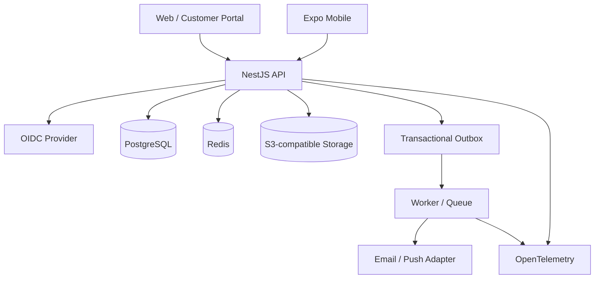

# معماری هدف و اصول مرزبندی

## تصمیم پایه
Modular Monolith برای API؛ Next.js برای وب و پورتال مشتری؛ Expo/React Native برای iOS/Android؛ PostgreSQL منبع حقیقت؛ Redis برای cache/queue backing؛ object storage سازگار با S3 برای فایل؛ worker برای کارهای پس‌زمینه.

## دیاگرام

## مرز ماژول‌ها
Identity & Access؛ Organization & Teams؛ CRM؛ Work Management؛ Support & SLA؛ Activities؛ Collaboration؛ Files؛ Notifications؛ Automation؛ Search؛ Reporting؛ Audit؛ Integrations.

## قوانین وابستگی
- Domain نباید به UI یا framework وابسته باشد.
- Application layer use case را orchestrate می‌کند.
- Infrastructure شامل DB، provider و queue adapter است.
- ماژول‌ها از service/API داخلی یا domain event استفاده کنند؛ دستکاری بی‌قاعده جدول‌های همدیگر ممنوع.
- `packages/contracts` فقط قراردادهای عمومی است؛ قوانین authorization در کلاینت مشترک و قابل اعتماد نیستند.

## الگوی درخواست
1. parse/validate ورودی.
2. authenticate کاربر یا service account.
3. resolve organization از membership معتبر.
4. authorize عمل و scope موجودیت.
5. اجرای use case با transaction و optimistic concurrency در صورت نیاز.
6. نوشتن داده و audit/outbox در یک transaction منطقی.
7. ارسال response با requestId و error model ثابت.
8. worker event را idempotent تحویل می‌دهد و retry محدود دارد.

## مقیاس و جداسازی سرویس
تا زمانی که latency، تیم‌های مستقل، throughput، fault isolation یا نیاز deployment مستقل سنجیده نشده‌اند، سرویس جدا نسازید. جداسازی زمانی توجیه دارد که owner، قرارداد، telemetry، data ownership و عملیات مستقل قابل تعریف باشد.
