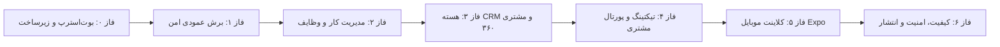

# برنامه جامع فازبندی و تسک‌های اجرایی پلتفرم CRM

**تاریخ تدوین:** ۲۴ اکتبر ۲۰۲۶  
**وضعیت:** مصوب و آماده اجرای گام‌به‌گام با موتور ورک‌فلو ایجنت‌ها  
**معماری:** Modular Monolith (NestJS + Next.js App Router + Expo + PostgreSQL/Prisma + Redis/BullMQ)

---

## ۱. فازبندی کلان پروژه

---

## ۲. تسک‌های تفصیلی به تفکیک فاز

### فاز ۰ — آماده‌سازی، ممیزی و بوت‌استرپ مخزن (انجام‌شده)
- [x] استخراج استارترپک و بررسی ۸۷ فایل مرجع و نیازمندی‌ها
- [x] تنظیم و همگام‌سازی نسخه‌های موتور اجرا (`package.json`)
- [x] نصب پکیج‌ها با `pnpm` و قفل lockfile
- [x] تولید تایپ‌ها و کلاینت Prisma برای schema پایه
- [x] راستی‌آزمایی build، typecheck و آزمون‌های اولیه (همه با موفقیت عبور کردند)
- [x] راه‌اندازی مخزن Git محلی

### فاز ۱ — برش عمودی امن (Secure Vertical Slice) [در حال اجرا]
- **تسک ۱.۱:** ایجاد ماژول `Identity & Access` در NestJS:
  - گارد و دکوراتور احراز هویت (`AuthGuard`, `@CurrentUser`)
  - استخراج خودکار سشن و عضویت فعال کاربر
  - اندپوینت `GET /api/v1/me` و `GET /api/v1/workspaces`
- **تسک ۱.۲:** پیاده‌سازی موتور مجوزدهی و تفکیک سازمانی (Multi-tenant Scope):
  - استخراج امن `organizationId` از عضویت احراز هویت‌شده (رد هرگونه مقدار ارسالی غیرمجاز از کلاینت)
  - انطباق با جدول `docs/permission-matrix.csv` و سیاست Deny-by-default
- **تسک ۱.۳:** پیاده‌سازی ماژول هسته وظایف (`Tasks Module`):
  - اندپوینت‌های `GET /api/v1/tasks/my-work` و `GET /api/v1/tasks` (با pagination/filter)
  - اندپوینت `POST /api/v1/tasks` (ایجاد تسک با اعتبارسنجی ورودی)
  - اندپوینت `POST /api/v1/tasks/:id/transitions` (ماشین وضعیت دامنه `@crm/domain`، بررسی concurrency با version، ثبت AuditEvent و Outbox)
- **تسک ۱.۴:** پوشش تست‌های منفی و امنیتی:
  - کاربر ناشناس -> ۴۰۱
  - کاربر بدون نقش مجاز -> ۴۰۳
  - تلاش برای دسترسی به تسک سازمان دیگر (IDOR) -> عدم افشا / ۴۰۴
  - انتقال وضعیت غیرمجاز -> خطای دامنه
- **تسک ۱.۵:** پیاده‌سازی لایه فرانت‌اند وب (`apps/web`):
  - داشبورد تعاملی «کارهای من» (My Work)
  - فرم ایجاد تسک، جدول و کارت تسک‌ها
  - اکشن‌های تغییر وضعیت با مدیریت stateهای Loading, Empty, Error و Success

### فاز ۲ — مدیریت کار و پروژه‌ها (Work & Project Management)
- **تسک ۲.۱:** گسترش موجودیت‌های پروژه، تخصیص تیم و ناظران (Watchers)
- **تسک ۲.۲:** گراف وابستگی‌های تسک (`TaskDependency`) و الگوریتم جلوگیری از چرخه (Cycle Detection)
- **تسک ۲.۳:** سیستم کامنت‌ها با تفکیک سیاست دیداری (`INTERNAL` vs `CUSTOMER_SHARED`)
- **تسک ۲.۴:** نماهای تعاملی Kanban Board و تقویم در وب

### فاز ۳ — هسته CRM و دید ۳۶۰ درجه مشتری (CRM & Customer 360)
- **تسک ۳.۱:** ماژول‌های Accounts، Contacts، Leads، Deals
- **تسک ۳.۲:** خط‌لوله فروش (Pipelines) و محاسبات مالی با واحدهای صحیح (`amountMinor` و `currency`)
- **تسک ۳.۳:** تایم‌لاین یکپارچه فعالیت‌ها (Customer Timeline)
- **تسک ۳.۴:** الگوریتم Deduplication (تطبیق ایمیل/تلفن، پیشنهاد هوشمند ادغام با قابلیت Audit)
- **تسک ۳.۵:** تبدیل اتمیک و Idempotent سرنخ به مخاطب/شرکت/فرصت

### فاز ۴ — پشتیبانی، تیکتینگ و پورتال مشتری (Support & Customer Portal)
- **تسک ۴.۱:** چرخه عمر Ticket با شماره‌گذاری یکتا (`TKT-1001`)
- **تسک ۴.۲:** تفکیک قطعی در سطح دیتابیس و کوئری بین یادداشت‌های داخلی کارشناسان و پاسخ‌های مشتری
- **تسک ۴.۳:** موتور محاسبه هوشمند SLA بر اساس تقویم کاری، تعطیلات و وضعیت توقف
- **تسک ۴.۴:** پورتال اختصاصی مشتری در روت گروپ مستقل وب (`apps/web/src/app/(portal)`)

### فاز ۵ — هماهنگی و کلاینت موبایل (Expo Mobile)
- **تسک ۵.۱:** اتصال کلاینت موبایل به قراردادهای اشتراکی API
- **تسک ۵.۲:** ذخیره‌سازی امن نشست و احراز هویت
- **تسک ۵.۳:** صفحات My Work و جزئیات تسک در موبایل با پشتیبانی از خطاهای شبکه

### فاز ۶ — ارزیابی کیفی، امنیت و چک‌لیست انتشار (Hardening & Release)
- **تسک ۶.۱:** اسکن لایسنس‌ها، secretها و آسیب‌پذیری‌ها
- **تسک ۶.۲:** تست بار و سنجش تاخیر اندپوینت‌های پرتردد
- **تسک ۶.۳:** تدوین راهنماهای اجرایی Runbook و برنامه بازیابی اضطراری (Disaster Recovery)

---

## ۳. شاخص‌های پذیرش (Definition of Done)
1. کلیه منطق‌های دامنه در ماژول‌های مستقل پیاده و دارای تست واحد باشند.
2. هیچ دسترسی یا مجوزی صرفاً با مخفی کردن المان UI کنترل نشده باشد؛ همه در API کنترل شوند.
3. تفکیک کامل تیکت‌ها و تسک‌های بین‌سازمانی (Multi-tenant Isolation) تضمین شده باشد.
4. فرانت‌اند در تمامی بخش‌ها حالت‌های Loading، Empty، Error و Permission Denied را به زیبایی پوشش دهد.
