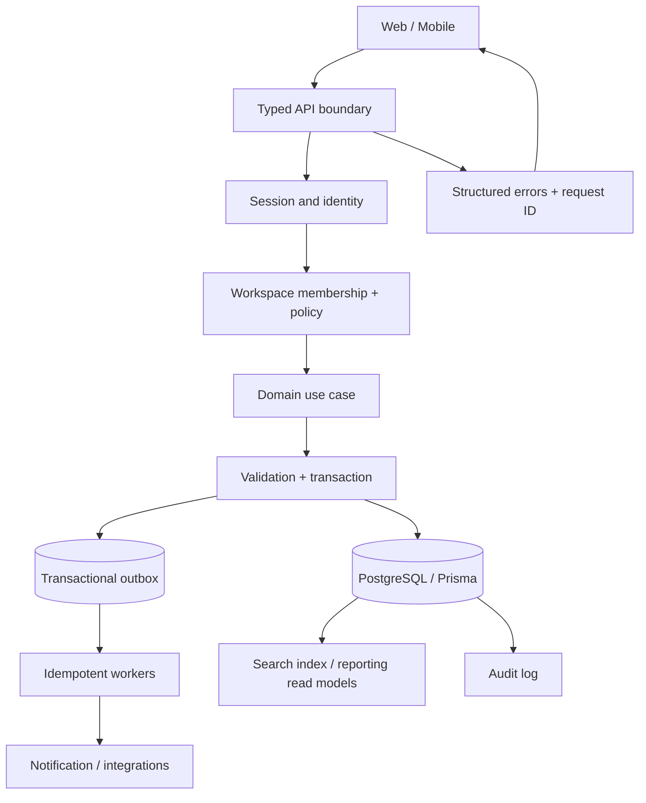

# System seams و مسیر end-to-end

## Contract checks at each seam
- UI/API: generated/checked types، loading/error/empty، abort و retry semantics.
- API/identity: invalid/expired/revoked session tests.
- policy/domain: tenant/role/resource checks.
- domain/database: constraints، transaction، concurrency و migrations.
- outbox/worker: duplicate delivery، retry، poison message و DLQ.
- index/reporting: eventual consistency مشخص و rebuild strategy.
- logs/telemetry: redaction، request/correlation ID، alert actionable.

هر جریان P0 باید sequence diagram یا flow کوتاه و test evidence داشته باشد. این نمودار target architecture است، نه ادعای پیاده‌سازی فعلی.
