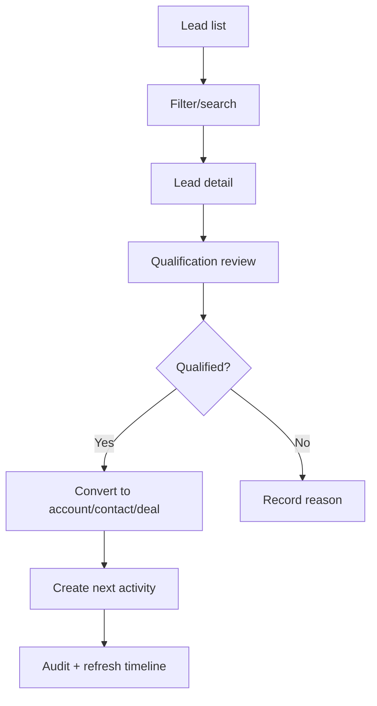
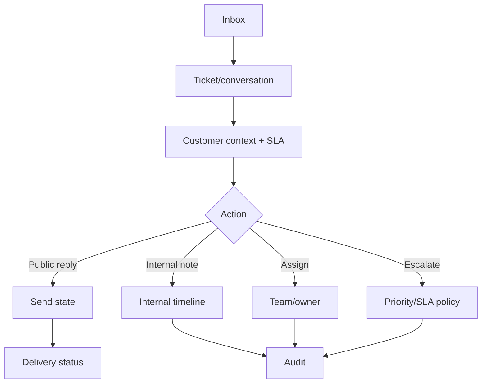

# سفرهای کاربری و فلوهای پذیرش

## Lead تا Deal

**پذیرش:** conversion transactionally سازگار است؛ retry/double-click رکورد تکراری نمی‌سازد؛ permission سمت API؛ audit و activity با نتیجه سازگارند.

## Support request

**پذیرش:** reply و internal note مستقل؛ send state `queued/sent/failed`; idempotency؛ SLA server-side.

## کار روزانه
ورود → My Work → overdue/due tasks → filter و save view → task detail/drawer → تغییر status/owner/date → server confirmation → notification/audit.

## گزارش
انتخاب report → timezone/date/filter → تعریف metric و freshness → drill-down به records با همان access policy → export بعد از permission check و audit.

## دعوت عضو
Members → invite email/team/role → preview capability → invitation با expiry/token یکبارمصرف → پذیرش و membership → revoke با invalidation نشست طبق policy.

## شکست‌های مشترک
شبکه قطع، session expired، permission revoked، stale data، validation، 5xx و retry باید در تمام journeyها لحاظ شوند؛ عملیات حساس بعد از failure باید reconcile شود نه اینکه success کاذب بگوید.
