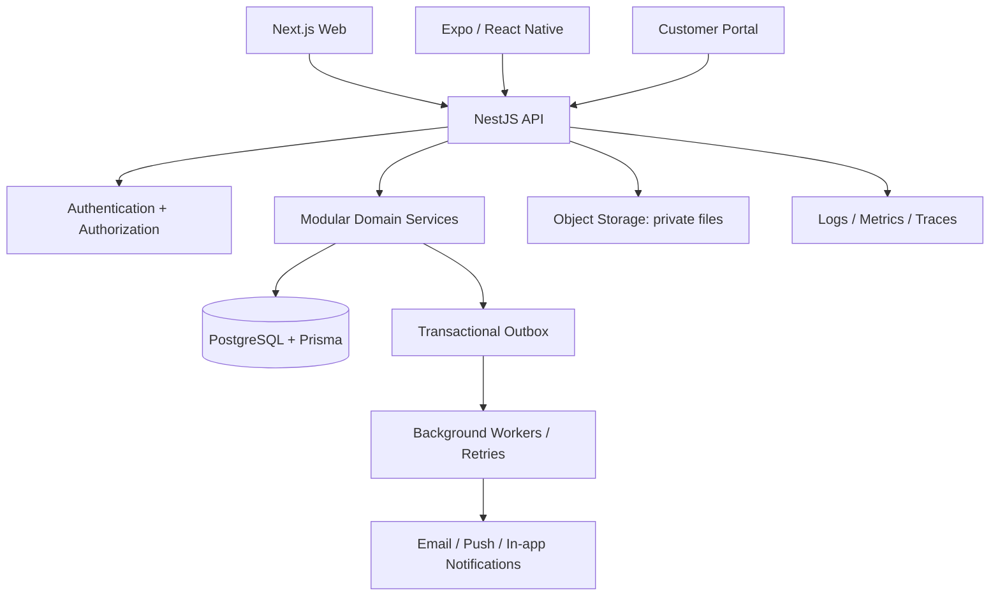
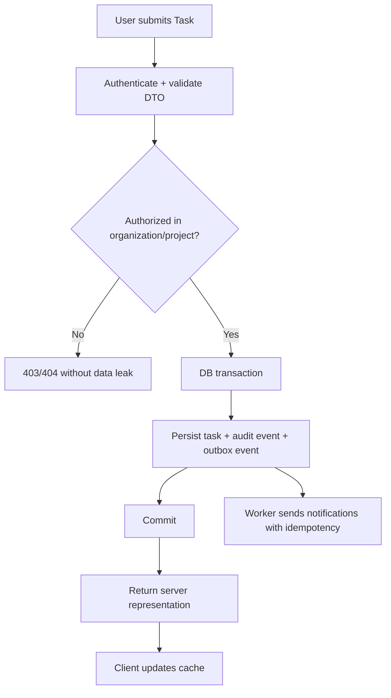
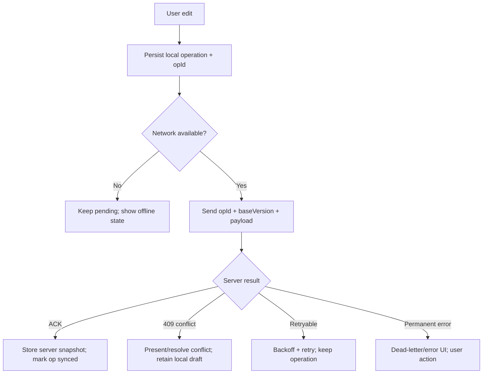

# نقشه تحقیق، منابع متن‌باز و رودمپ اجرایی CRM Platform

**نسخه سند:** 1.0 — **تاریخ تدوین:** ۲۴ اکتبر ۲۰۲۶  
**مخزن هدف:** https://github.com/ali39999-hue/crm-platform  
**مبنای فنی فعلی:** Next.js + NestJS + Expo/React Native + Prisma + PostgreSQL؛ تصمیمات نهایی باید با فایل‌های موجود مخزن و نسخه‌های نصب‌شده تطبیق داده شوند.

> دامنه «تمام مخزن‌های موجود» عملاً نامحدود است. این بسته یک کاتالوگ curated از منابع مرتبط و قابل اقدام ارائه می‌کند؛ نه ادعای فهرست کامل اینترنت. لینک‌ها نقطه شروع تحقیق هستند و آخرین commit، انتشار، مجوز، وضعیت نگهداری و امنیت هر dependency باید هنگام انتخاب کنترل شود.

## 1. تصمیم‌های اجرایی خلاصه

1. **محصول مرجع برای UX:** Twenty برای Customer 360 و CRM؛ Plane برای task/board/project؛ Chatwoot برای inbox/support؛ Leantime یا Taiga برای مقایسه جریان مدیریت کار. این‌ها benchmark محصول هستند؛ قرار نیست کل آن‌ها را کپی کنیم.
2. **وب:** یک Design System انتخاب کنید. پیشنهاد baseline برای کنترل کد و سفارشی‌سازی: Tailwind + shadcn/ui + primitives دسترس‌پذیر Radix. برای data grid، TanStack Table؛ برای server state، TanStack Query؛ برای فرم، React Hook Form + Zod؛ برای drag & drop، dnd-kit. هر سه انتخاب UI/forms/DnD باید در prototype واقعی و version-locked اثبات شوند.
3. **موبایل:** Expo/React Native + Expo Router مطابق استک موجود. یک component/style strategy انتخاب کنید (NativeWind یا Tamagui یا gluestack/RN Paper؛ نه همه با هم). صف آفلاین و sync را feature مستقل طراحی کنید؛ local state هرگز منبع حقیقت سرور نیست.
4. **Backend:** NestJS + Prisma + PostgreSQL برای مرجع داده؛ modular monolith؛ API و policyها مستقل از UI؛ tenant scope در query و mutation؛ audit history و outbox برای رویدادهای قابل retry.
5. **انتخاب dependency:** ابتدا نیاز و acceptance criteria، سپس prototype، بعد license/security check، و در پایان ادغام. هیچ مخزن کامل را فقط به خاطر زیبایی یا تعداد ستاره‌ها clone/merge نکنید.

## 2. روش استفاده از کاتالوگ

- فایل `REPOSITORY_CATALOG.csv` شامل مخزن‌ها، هدف، اقدام توصیه‌شده، اولویت و یادداشت بررسی مجوز است.
- **P0**: برای معماری فعلی یا اثبات مسیر اصلی مهم؛ **P1**: گزینه‌های نزدیک به فاز جاری؛ **P2**: مرجع آگاهی/فاز بعد یا جایگزین.
- `مرجع UX` یعنی محصول را اجرا کنید، flowها را تحلیل کنید، سپس با نیاز کاربران خودتان طراحی کنید؛ کد را خودکار کپی نکنید.
- `کتابخانه dependency` یعنی تنها ماژول‌های لازم را نصب کنید؛ نسخه را pin کنید و مجوز/transitive dependencies را ثبت کنید.
- همه لایسنس‌ها را در زمان انتخاب از فایل LICENSE و license package بررسی کنید. یک repo ممکن است چند مجوز، فایل تجاری یا قابلیت enterprise محدود داشته باشد. برای استفاده تجاری/توزیع عمومی، بررسی حقوقی لازم است.

## 3. نمونه‌های محصولی که باید عملی بررسی شوند

| محصول | چه چیزی را مطالعه کنیم | مواردی که نباید بدون تصمیم انتقال دهیم |
|---|---|---|
| [Twenty](https://github.com/twentyhq/twenty) | Customer 360، record layouts، relation views، pipeline و command/search UX | مجوز کل پروژه و فایل‌های enterprise؛ معماری بزرگ و همه dependencyها |
| [Plane](https://github.com/makeplane/plane) | board/list/timeline، task detail، project navigation، cycle و filter | تمام data model یا runtime بدون تطبیق با دامنه CRM شما |
| [Chatwoot](https://github.com/chatwoot/chatwoot) | shared inbox، assignment، conversation timeline، support workflows | ساخت چت/کانال‌های زیاد پیش از نیاز واقعی |
| [Frappe CRM](https://github.com/frappe/crm) | deal/contact/activity model و journey فروش | انتقال codebase با stack متفاوت بدون بررسی هزینه مهاجرت |
| [Leantime](https://github.com/Leantime/leantime) / [Taiga](https://github.com/taigaio/taiga) | ساده‌سازی برنامه‌ریزی، goal/sprint/backlog | feature parity کامل در MVP |
| [Primer React](https://github.com/primer/react) / [Atlassian Design](https://atlassian.design/) | issue-tracker patterns، accessibility، dense data UI | کپی برند/دارایی یا ترکیب چند design language در یک صفحه |

## 4. UI/UX benchmark و الگوهای غیرکدی

این‌ها برای مشاهده الگو و ساخت تجربه هستند، نه لزوماً منابع قابل clone:
- [Atlassian Design System](https://atlassian.design/) — issue tracker، navigation، content design، status و collaboration.
- [GitHub Primer](https://primer.style/) — ابزارهای کاری متراکم، keyboard focus و issue-oriented interface.
- [Material Design 3](https://m3.material.io/) — اصول تعامل، typography، color system و رفتار responsive.
- [Fluent 2](https://fluent2.microsoft.design/) — productivity UI و تراکم کنترل‌ها در محصولات سازمانی.
- [IBM Carbon](https://carbondesignsystem.com/) — جدول‌های داده‌ای و patternهای سازمانی.
- [Adobe Spectrum](https://spectrum.adobe.com/) — دسترس‌پذیری و کنترل‌های پیشرفته.
- برای مقایسه محصول: Jira، Linear، Asana، ClickUp، HubSpot، Attio، Zendesk و Intercom را از منظر flow/interaction مشاهده کنید؛ ظاهر و assets اختصاصی‌شان را کپی نکنید.

## 5. نقشه UI و صفحه‌ها

### App Shell و ناوبری

- sidebar قابل collapse: Overview، My Work، Tasks، Projects، Customers، Sales Pipeline، Support Inbox، Calendar، Reports، Knowledge Base، Automations و Admin (فقط برای نقش مجاز).
- top bar: organization/workspace switcher، global search، create action، notifications، help، profile.
- command palette با دسترسی keyboard؛ quick-create و navigation shortcuts.
- responsive: دسکتاپ با sidebar و data grid؛ tablet با sidebar کم‌عرض؛ موبایل با bottom navigation محدود به 4–5 مقصد و actionهای پرتکرار.
- routeها و query string باید filter/sort/page را منعکس کنند تا refresh، share و back/forward قابل اتکا باشد.

### صفحات و معیار UX

| صفحه | الگوی اصلی | معیارهای پذیرش UX |
|---|---|---|
| Login/Session | فرم کوتاه، خطاهای دقیق، loading و session expiry | keyboard/password manager مناسب؛ خطای auth اطلاعات اضافه افشا نکند |
| Overview | KPI، کارهای امروز، overdue، activity، CTA | هر KPI به فهرست قابل drill-down برسد؛ نه فقط کارت تزئینی |
| My Work | list/board، due date، priority، assignee، quick actions | task با یک تعامل باز شود؛ bulk action و filter حفظ شود |
| Task Detail | drawer یا صفحه مستقل، description، checklist، comments، activity | تغییرهای حساس تأیید و audit شوند؛ خطاها بدون از دست رفتن متن |
| Project | board/list/calendar، members، progress، milestones | نماها data source مشترک داشته باشند؛ فیلترها synchronized باشند |
| Customer 360 | profile، people، deals، tasks، tickets، files، timeline | همه ارتباطات tenant-scoped؛ create activity در context مشتری |
| Pipeline | stage columns/list، forecast، next action، owner | stage changes با قواعد سرور؛ dedupe و history برای deal |
| Support Inbox | queue، assigned-to-me، SLA, conversation, internal note | reply و internal note از لحاظ UI و permission آشکارا متفاوت |
| Search | global results با type filters و recent items | scope نتایج بر اساس مجوز؛ keyboard navigation و empty query state |
| Notification Center | unread, filters, links و preferences | mark-read idempotent؛ لینک مقصد مجدداً authorization می‌شود |
| Admin | users, teams, roles, stages, custom fields, automation | پیش‌نمایش و confirmation برای تغییرات سازمانی؛ audit trail |
| Mobile My Work | task list، due/priority، detail، comments، offline badge | primary actions reachable با یک دست؛ hit targets بزرگ و feedback سریع |
| Customer Portal | tickets, status, comment, attachments و profile | از staff routes کاملاً جدا؛ دسترسی object-level تست شود |

### Design tokens و component standards

- یک منبع مرجع token: `color`, `surface`, `text`, `border`, `spacing`, `radius`, `shadow`, `z-index`, `motion`, `breakpoints`.
- رنگ وضعیت علاوه بر رنگ با label/icon نمایش داده شود؛ برای success/error/warning فقط رنگ کافی نیست.
- هر field: label، help text در صورت نیاز، required indicator، validation، disabled، loading و error.
- برای هر component در Storybook stateهای default، hover، focus-visible، pressed، disabled، loading، empty/error و mobile ثبت شود.
- typography: متن بدنه خوانا، line-height کافی، عدد و تاریخ locale-aware؛ RTL باید در layout، icon direction و keyboard navigation تست شود.
- motion: کوتاه، هدفمند، قابل احترام به `prefers-reduced-motion`؛ هیچ transition برای هر تعامل به‌صورت پیش‌فرض اضافه نشود.

## 6. معماری هدف

### اصول معماری

- **Modular Monolith در ابتدا:** ماژول‌های identity, organizations, tasks, projects, crm, support, files, notifications, audit, reporting؛ dependencyها یک‌طرفه و مرزها روشن باشند.
- **PostgreSQL منبع حقیقت:** داده عملیاتی از repository درون‌حافظه‌ای خوانده/نوشته نشود؛ in-memory فقط در test adapter باشد.
- **Authorization در backend:** بررسی role به تنهایی کافی نیست؛ tenant/resource ownership در هر query و mutation enforce شود.
- **Outbox برای عملیات جانبی:** تغییر Task و ایجاد event در یک transaction؛ worker idempotent؛ retry و dead letter قابل مشاهده.
- **REST/OpenAPI:** DTO و schemaها versioned؛ client contract generation و validation در CI.
- **Storage:** فایل خصوصی با metadata در DB، object storage و دانلود با signed short-lived URL؛ متن/فایل از tenant دیگر قابل دسترسی نباشد.
- **Realtime دیرتر:** ابتدا polling/refresh قابل اتکا و event contracts؛ WebSocket پس از اثبات نیاز به latency پایین.
- **Search جداگانه فقط پس از اندازه‌گیری:** ابتدا PostgreSQL indexes/tsvector؛ پس از benchmark بین Meilisearch، Typesense و OpenSearch تصمیم بگیرید.

## 7. مهم‌ترین flowها

### Task lifecycle

### Offline mobile sync

**قاعده حیاتی:** پاک کردن صف محلی فقط بعد از ACK قطعی سرور مجاز است. retry باید `opId`/idempotency key داشته باشد؛ تغییرات مشتری/کارمند و فایل آفلاین باید با tenant و permission مجدداً کنترل شوند.

## 8. ترتیب فازها

Backlog با جزئیات در `PHASE_BACKLOG.csv` قرار دارد. زمان‌ها برآورد اولیه‌اند و به ظرفیت تیم و وضعیت واقعی مخزن وابسته‌اند. هر فاز زمانی بسته می‌شود که acceptance criteria و تست‌ها پاس شوند؛ صرف merge شدن کد معیار اتمام نیست.

### F0 — تحقیق و تصمیم‌های معماری (هفته 1)

**هدف:** بدون توسعه فیچر جدید؛ تثبیت scope و گزینه‌های dependency

- [ ] **F0-01 — ثبت نقش‌ها و پرسونای کارکنان، مدیر، فروش، پشتیبانی و مشتری** (`P0`, owner: Product). معیار پذیرش: RACI/permission matrix و 5 مسیر کار اصلی تأیید شده‌اند
- [ ] **F0-02 — تعریف MVP و out-of-scope** (`P0`, owner: Product/Tech Lead). معیار پذیرش: اولویت‌های P0/P1/P2 و عدم‌هدف‌ها ثبت شده‌اند
- [ ] **F0-03 — ثبت ADR برای UI stack، auth، offline، search، notifications** (`P0`, owner: Tech Lead). معیار پذیرش: هر تصمیم گزینه‌ها، دلیل و ریسک دارد
- [ ] **F0-04 — ممیزی LICENSE برای تمام کدها، فونت‌ها، آیکون‌ها و قالب‌ها** (`P0`, owner: Engineering/Legal). معیار پذیرش: SBOM/license inventory با notice obligations تولید شده
- [ ] **F0-05 — Benchmark UX از Twenty، Plane، Chatwoot و Jira/Linear/HubSpot** (`P0`, owner: Design). معیار پذیرش: اسکرین/flow matrix داخلی ثبت شده؛ کپی ظاهری بدون طراحی محصول انجام نشده

### F1 — سبز کردن CI و مهندسی پایه (هفته 1)

**هدف:** قابلیت build/test/release قابل تکرار

- [ ] **F1-01 — اصلاح ترتیب نصب pnpm و setup-node در GitHub Actions** (`P0`, owner: Platform). معیار پذیرش: CI از clean runner تا install بدون خطا می‌رسد
- [ ] **F1-02 — یکپارچه کردن packageManager، Node version و lockfile** (`P0`, owner: Platform). معیار پذیرش: clean install با frozen lockfile موفق است
- [ ] **F1-03 — اضافه کردن lint، typecheck، unit tests و build به CI** (`P0`, owner: Platform). معیار پذیرش: همه gateها اجباری و fail-fast هستند
- [ ] **F1-04 — تثبیت env schema و .env.example بدون secret** (`P0`, owner: Backend/Platform). معیار پذیرش: startup با متغیر ناقص خطای واضح می‌دهد؛ secret در Git نیست
- [ ] **F1-05 — Docker Compose توسعه، health checks و seed امن** (`P1`, owner: Platform). معیار پذیرش: دیتابیس و Redis با healthcheck آماده هستند
- [ ] **F1-06 — قواعد PR، CODEOWNERS، branch protection و conventional commits** (`P1`, owner: Maintainers). معیار پذیرش: تغییر main بدون green checks ممنوع است

### F2 — Design System و UX foundations (هفته 2–3)

**هدف:** ثبات بصری، دسترس‌پذیری و responsive

- [ ] **F2-01 — ثبت visual tokens: color, spacing, radius, typography, elevation** (`P0`, owner: Design/FE). معیار پذیرش: tokens در یک منبع مشترک تعریف شده‌اند
- [ ] **F2-02 — انتخاب یک پایه UI؛ اجرای prototype 3 صفحه با shadcn/Radix در برابر kit جایگزین** (`P0`, owner: Design/FE). معیار پذیرش: تصمیم براساس usability, RTL, data density و maintenability ثبت شده
- [ ] **F2-03 — ساخت Button, Input, Select, Combobox, Dialog, Drawer, Toast, Badge, Avatar** (`P0`, owner: FE). معیار پذیرش: states default/hover/focus/disabled/loading/error در Storybook وجود دارند
- [ ] **F2-04 — ساخت AppShell, sidebar, topbar, breadcrumb, command/search palette** (`P0`, owner: FE). معیار پذیرش: keyboard navigation و active route قابل تست است
- [ ] **F2-05 — ساخت DataTable استاندارد با sort/filter/selection/pagination** (`P0`, owner: FE). معیار پذیرش: server-side state و URL filters پایدارند؛ empty/error/loading پوشش دارد
- [ ] **F2-06 — ساخت فرم‌الگوها و validation messages فارسی/انگلیسی** (`P0`, owner: FE/Design). معیار پذیرش: خطای field-level قابل فهم است و focus به خطا منتقل می‌شود
- [ ] **F2-07 — تکمیل RTL/LTR، locale dates/numbers و responsive breakpoints** (`P0`, owner: FE). معیار پذیرش: صفحات حیاتی در 360px، 768px و desktop قابل استفاده‌اند
- [ ] **F2-08 — Accessibility baseline WCAG 2.2 AA برای flowهای حیاتی** (`P0`, owner: QA/Design). معیار پذیرش: keyboard-only، focus visibility و axe checks قبول هستند
- [ ] **F2-09 — مرجع visual regression و Storybook review** (`P1`, owner: FE/QA). معیار پذیرش: stories برای stateهای کلیدی و review checklist وجود دارد

### F3 — Task vertical slice واقعی (هفته 3–4)

**هدف:** یک قابلیت کامل از UI تا DB و audit

- [ ] **F3-01 — تکمیل مدل Task, Project, Membership, Comment, Attachment metadata** (`P0`, owner: Backend). معیار پذیرش: FKها، indexes، tenant_id و deletion policy مستند شده‌اند
- [ ] **F3-02 — ایجاد Prisma migration معتبر و seed داده فقط در dev/test** (`P0`, owner: Backend). معیار پذیرش: migration از دیتابیس خالی اجرا و rollback/restore plan مشخص است
- [ ] **F3-03 — جایگزینی InMemoryTaskRepository با PrismaTaskRepository** (`P0`, owner: Backend). معیار پذیرش: داده بعد از restart باقی می‌ماند؛ repository test موجود است
- [ ] **F3-04 — DTO validation، auth guard و organization scope در همه endpointها** (`P0`, owner: Backend/Security). معیار پذیرش: negative tests منع cross-tenant access را اثبات می‌کنند
- [ ] **F3-05 — گردش وضعیت Task با transition map سمت سرور** (`P0`, owner: Backend). معیار پذیرش: transition نامعتبر رد و transition مجاز audit می‌شود
- [ ] **F3-06 — تاریخچه audit append-only و correlation/request id** (`P0`, owner: Backend). معیار پذیرش: actor, entity, action, timestamp و metadata ثبت می‌شود؛ اطلاعات حساس redact است
- [ ] **F3-07 — وب: جایگزینی INITIAL_TASKS با API و cache invalidation** (`P0`, owner: FE). معیار پذیرش: CRUD به server می‌رود؛ reload همان داده را بازیابی می‌کند
- [ ] **F3-08 — وب: loading, empty, error, retry, optimistic update و conflict handling** (`P0`, owner: FE). معیار پذیرش: موفقیت کاذب وجود ندارد و retry duplicate نمی‌سازد
- [ ] **F3-09 — API contract/OpenAPI و contract tests** (`P1`, owner: Backend/QA). معیار پذیرش: spec با implementation سازگار و در CI اعتبارسنجی می‌شود
- [ ] **F3-10 — E2E مسیر create → update → reload → permissions** (`P0`, owner: QA). معیار پذیرش: سناریوی حیاتی روی CI pass می‌شود

### F4 — هویت، نقش‌ها و امنیت سازمانی (هفته 4–5)

**هدف:** مجوزهای واقعی نه صرفاً مخفی کردن UI

- [ ] **F4-01 — تعریف permissions بر اساس resource/action/scope** (`P0`, owner: Security/Product). معیار پذیرش: matrix برای member, manager, admin, support, customer تأیید شده
- [ ] **F4-02 — Backend authorization policy و object-level access checks** (`P0`, owner: Backend). معیار پذیرش: هر query و mutation tenant/ownership scope دارد
- [ ] **F4-03 — امن‌سازی session/cookie/token و refresh/logout/revocation** (`P0`, owner: Backend/Security). معیار پذیرش: session lifecycle و CSRF/XSS threat review انجام شده
- [ ] **F4-04 — rate limit، brute-force protection و security headers** (`P1`, owner: Backend/Platform). معیار پذیرش: تست abuse و baseline headers در CI/pass گزارش شده
- [ ] **F4-05 — file upload allowlist، size limits، malware scanning plan و signed access** (`P1`, owner: Backend/Security). معیار پذیرش: دسترسی فایل براساس مجوز و tenant کنترل می‌شود
- [ ] **F4-06 — privacy, retention, export/delete workflow و PII redaction** (`P1`, owner: Product/Security). معیار پذیرش: policyها و auditهای مربوط مستند شده‌اند
- [ ] **F4-07 — threat model و dependency/SBOM scan** (`P0`, owner: Security). معیار پذیرش: ریسک‌های بالا owner و mitigation دارند

### F5 — CRM مشتری و فعالیت‌ها (هفته 5–7)

**هدف:** Customer 360 و pipeline واقعی

- [ ] **F5-01 — مدل Organization/Company, Contact, Lead, Deal, Activity** (`P0`, owner: Backend). معیار پذیرش: روابط و unique constraints مناسب مستند و تست شده‌اند
- [ ] **F5-02 — تشخیص duplicate با email/phone normalization و merge review** (`P1`, owner: Backend/Product). معیار پذیرش: duplicateها حذف خودکار مخرب نمی‌شوند؛ merge audit دارد
- [ ] **F5-03 — Customer 360: profile, relations, activities, tickets, tasks** (`P0`, owner: FE/Backend). معیار پذیرش: هر تب با data واقعی و permission مناسب کار می‌کند
- [ ] **F5-04 — pipeline stages و transition rules قابل تنظیم** (`P1`, owner: Backend/FE). معیار پذیرش: مراحل توسط admin تغییر می‌کنند بدون deploy جدید
- [ ] **F5-05 — activity timeline با pagination و event ordering** (`P1`, owner: Backend/FE). معیار پذیرش: timeline پایدار، مرتب و tenant-scoped است
- [ ] **F5-06 — CSV import/export با validation، preview، dry-run و audit** (`P1`, owner: Backend/FE). معیار پذیرش: خطاهای هر ردیف گزارش می‌شوند و import تکراری کنترل شده است
- [ ] **F5-07 — جست‌وجوی global اولیه با Postgres و benchmark** (`P1`, owner: Backend). معیار پذیرش: نتایج با permission/tenant scope محدود می‌شوند

### F6 — Helpdesk، SLA و notification (هفته 7–8)

**هدف:** قابلیت رسیدگی و خبررسانی قابل اعتماد

- [ ] **F6-01 — Ticket lifecycle، assignment، priority و status transition** (`P1`, owner: Backend). معیار پذیرش: state machine و audit test دارند
- [ ] **F6-02 — SLA policy: business hours, pauses, escalation** (`P1`, owner: Backend/Product). معیار پذیرش: محاسبه در timezone و خارج ساعات کاری تست شده
- [ ] **F6-03 — notification outbox، retries، idempotency و dead-letter visibility** (`P0`, owner: Backend). معیار پذیرش: رویداد از دست نمی‌رود و retry duplicate notification تولید نمی‌کند
- [ ] **F6-04 — in-app notification center و read/unread state** (`P1`, owner: FE/Backend). معیار پذیرش: permission و pagination رعایت می‌شود
- [ ] **F6-05 — email push adapters و preference per user** (`P2`, owner: Backend). معیار پذیرش: ارسال با provider تست و opt-out/preference رعایت می‌شود
- [ ] **F6-06 — Customer portal محدود و کاملاً جدا از staff routes** (`P1`, owner: FE/Backend/Security). معیار پذیرش: negative cross-role tests برای API/UI می‌گذرند

### F7 — موبایل واقعی و آفلاین (هفته 8–10)

**هدف:** استفاده امن روی دستگاه در شبکه ضعیف

- [ ] **F7-01 — اتصال app به API با auth و error mapping مشترک** (`P0`, owner: Mobile/Backend). معیار پذیرش: login/session/refresh/logout و timeout تست می‌شوند
- [ ] **F7-02 — لیست My Tasks، details، status update و comments با داده واقعی** (`P0`, owner: Mobile). معیار پذیرش: داده سروری و حالت loading/error/empty واقعی است
- [ ] **F7-03 — صف local durable با outbox و operation id** (`P1`, owner: Mobile/Backend). معیار پذیرش: صف پس از restart باقی می‌ماند و duplicate write ندارد
- [ ] **F7-04 — sync protocol: ack, retry/backoff, conflict detection, dead-letter** (`P1`, owner: Mobile/Backend). معیار پذیرش: فقط ack server آیتم را از pending خارج می‌کند
- [ ] **F7-05 — secure storage برای credential/token و local cache minimization** (`P0`, owner: Mobile/Security). معیار پذیرش: secretها در AsyncStorage/plaintext نیستند
- [ ] **F7-06 — push notification deep links و permission preference** (`P2`, owner: Mobile/Backend). معیار پذیرش: routing و authorization مقصد دوباره از سرور بررسی می‌شود
- [ ] **F7-07 — offline, poor network, duplicate/reordered request E2E tests** (`P1`, owner: QA/Mobile). معیار پذیرش: سناریوها روی emulator/device تست شده‌اند

### F8 — اتوماسیون، گزارش و integrations (هفته 10–12)

**هدف:** گسترش پس از پایدار شدن core

- [ ] **F8-01 — workflow rules پایه: trigger, condition, action** (`P2`, owner: Backend/Product). معیار پذیرش: rules versioned، auditable و rate-limited هستند
- [ ] **F8-02 — background jobs، retry policy و visibility** (`P1`, owner: Backend/Platform). معیار پذیرش: job status و failure قابل مشاهده‌اند
- [ ] **F8-03 — reporting dashboards با aggregates سمت سرور** (`P1`, owner: Backend/FE). معیار پذیرش: queryها pagination/limits دارند و PII بی‌دلیل نمایش داده نمی‌شود
- [ ] **F8-04 — integrations API/webhooks با signature، retries و replay protection** (`P2`, owner: Backend/Security). معیار پذیرش: webhook idempotent و قابل مشاهده است
- [ ] **F8-05 — search engine مجزا فقط پس از benchmark Postgres** (`P2`, owner: Architecture). معیار پذیرش: داده/ترافیک benchmark دلیل انتخاب Meilisearch/Typesense/OpenSearch را ثابت می‌کند

### F9 — Production readiness (هفته 12+)

**هدف:** انتشار کنترل‌شده با SLO و rollback

- [ ] **F9-01 — CI security gates: dependency, secret, license, migration checks** (`P0`, owner: Platform/Security). معیار پذیرش: blocking checks و سیاست exception دارند
- [ ] **F9-02 — metrics, traces, structured logs و alerting** (`P1`, owner: Platform). معیار پذیرش: latency/error rate/queue/db pool dashboards و alerts دارند
- [ ] **F9-03 — load test و performance budgets برای core flows** (`P1`, owner: QA/Platform). معیار پذیرش: هدف‌ها روی محیط شبیه production اندازه‌گیری شده‌اند
- [ ] **F9-04 — backup/restore drill و disaster recovery runbook** (`P0`, owner: Platform/DBA). معیار پذیرش: restore واقعی در staging و RPO/RTO ثبت شده‌اند
- [ ] **F9-05 — staging rollout، smoke test، rollback procedure** (`P0`, owner: Release owner). معیار پذیرش: release از طریق checklist و rollback آزمایش‌شده انجام می‌شود
- [ ] **F9-06 — pilot با گروه داخلی، feedback و usability retest** (`P0`, owner: Product/Design). معیار پذیرش: task success, time-on-task و defect severity اندازه‌گیری می‌شود

## 9. تعریف Done مشترک برای همه تسک‌ها

- کد در جای درست معماری قرار گرفته و با patternهای هم‌خانواده سازگار است.
- permission و tenant isolation سمت سرور پیاده و با test منفی پوشش داده شده است.
- unit/integration/E2E مناسب وجود دارد و CI سبز است.
- loading/empty/error/retry/permission-denied و mobile/responsive states طراحی شده‌اند.
- accessibility check، keyboard/focus، RTL/LTR و reduced motion در محدوده مرتبط بررسی شده‌اند.
- logging/metrics و audit مناسب دارند؛ PII/token/secret در log نیست.
- migration، rollback/backup implications و runbook به‌روز هستند.
- مجوز کد، dependency و assetها بررسی و attributionها حفظ شده‌اند.
- release note و screenshots/recording UX برای تغییرات قابل مشاهده ارائه شده است.

## 10. ابزارهای UX و Quality Gate

1. **Storybook** برای catalog و state coverage؛ هر component حیاتی story داشته باشد.
2. **Playwright + Testing Library + Vitest** برای flows؛ سناریوهای اصلی بر اساس نقش و tenant تکرار شوند.
3. **axe-core/pa11y** برای کشف خودکار مشکلات accessibility؛ جایگزین تست دستی keyboard و screen reader نیست.
4. **Lighthouse و performance budgets** برای صفحه‌های اصلی؛ هدف باید بر اساس baseline واقعی تنظیم شود.
5. **Session replay/product analytics** فقط با سیاست privacy، محدودسازی PII و اطلاع‌رسانی سازمانی؛ برای داده حساس خاموش/ماسک شود.
6. **Usability testing:** حداقل 5 کاربر نماینده برای هر مسیر اصلی در هر چرخه؛ ثبت task success، time-on-task، error rate و درخواست کمک. عدد 5 نقطه شروع discovery است نه معیار آماری قطعی.

## 11. سیاست clone / fork / adopt

### Adopt package

برای کتابخانه‌هایی مثل TanStack Table، Zod، React Hook Form، dnd-kit و lucide: package رسمی، version pinned، license inventory، changelog review، tests و automated dependency scan.
### Copy selected components

برای shadcn-style components و templates: تنها فایل‌های مورد نیاز را بردارید؛ attribution/license header را حفظ کنید؛ provenance هر فایل در `THIRD_PARTY_NOTICES` ثبت شود؛ dependency و accessibility را تست کنید.
### Fork complete product

برای Twenty/Plane/Chatwoot و مشابه: فقط وقتی این راه انتخاب شود که product strategy عمداً به fork تبدیل شده، مجوزها پذیرفته شده، به‌روزرسانی upstream و امنیت fork owner دارد و هزینه تغییرات سفارشی و merge conflict برآورد شده باشد.
### Never do

- کل repository یک محصول را داخل monorepo کپی نکنید فقط برای استفاده از چند صفحه UI.
- AGPL/BSL/Sustainable Use را «MIT-like» فرض نکنید. Twenty دارای بخش‌های AGPL و برخی بخش‌های تجاری/استثناهاست؛ Outline از BSL 1.1 استفاده می‌کند؛ n8n از Sustainable Use License و بخش‌های Enterprise جداگانه استفاده می‌کند. متن مجوز همان نسخه مبناست.

## 12. معیار انتخاب repository

برای هر نامزد در GitHub Issues/PR/commits/release/security policy/license را بررسی کنید و به هرکدام امتیاز دهید:
- تناسب فنی و هم‌خوانی stack: 20%
- سازگاری مجوز و هزینه حقوقی: 20%
- کیفیت/پوشش تست و امنیت: 15%
- سلامت نگهداری و امکان به‌روزرسانی: 15%
- accessibility و کیفیت UX: 10%
- هزینه ادغام/نگهداری و اندازه dependency: 10%
- مستندات، API و نمونه‌ها: 10%.
اگر مجوز یا وضعیت نگهداری روشن نیست، امتیاز بالا هرگز مجوز ادغام نیست؛ نامزد تا رفع ابهام در وضعیت hold می‌ماند.

## 13. منابع رسمی برای شروع اعتبارسنجی

- GitHub repository directory: [CRM repositories](https://github.com/sneg55/awesome-open-source-crm)
- [shadcn/ui](https://github.com/shadcn-ui/ui) و [Radix Primitives](https://github.com/radix-ui/primitives) برای foundation و accessibility.
- [TanStack Table](https://github.com/TanStack/table) برای data grid؛ مستندات repo توصیف headless behavior، sorting/filtering/grouping و server-side use را ارائه می‌دهد.
- [Twenty LICENSE](https://github.com/twentyhq/twenty/blob/main/LICENSE) برای بررسی اجزای AGPL/commercial و مجوزهای package.
- [Frappe CRM](https://github.com/frappe/crm) و [Leantime](https://github.com/Leantime/leantime) برای مقایسه مجوزهای copyleft.
- [Outline LICENSE](https://github.com/outline/outline) و [n8n LICENSE](https://github.com/n8n-io/n8n/blob/master/LICENSE.md) برای نمونه source-available/BSL/Sustainable Use restrictions.
- [Atlassian Design](https://atlassian.design/), [Primer](https://primer.style/), [Material 3](https://m3.material.io/), [Fluent 2](https://fluent2.microsoft.design/), [Carbon](https://carbondesignsystem.com/), [Spectrum](https://spectrum.adobe.com/).

## 14. اقدامات بعدی همین حالا

1. ابتدا CI repository فعلی را سبز کنید تا baseline قابل اعتماد باشد.
2. اجرای عملی Twenty، Plane و Chatwoot را با یک checklist مقایسه کنید؛ فقط نیازهای واقعی را وارد scope کنید.
3. روی branch جدا، prototype کوتاه Design System بسازید: App Shell، Task List/Table، Task Detail drawer، Customer 360 header. با سه کاربر داخلی usability test کنید.
4. یک Task واقعی را از Next.js تا NestJS و PostgreSQL تکمیل کنید و تست cross-tenant اضافه کنید.
5. سپس CRM customer/deal و notification/outbox؛ بعد از پایداری API، mobile online flow؛ در نهایت offline sync.
6. هر مرحله با PR مستقل، CI green، evidence و changelog؛ push مستقیم بدون review یا بدون green check نداشته باشید.

## 15. محدودیت‌های این سند

- این فهرست حاصل گزینش منابع مرتبط است، نه ممیزی کامل source code همه repositoryها.
- ستاره، تاریخ آخرین commit، release و مجوز ثابت نیستند؛ پیش از انتخاب باید مجدداً از GitHub بررسی شوند.
- هیچ پروژه‌ای صرفاً بر اساس ظاهر یا تعداد ستاره به‌عنوان «بهترین مطلق» معرفی نشده است؛ بهترین انتخاب برای محصول شما باید با prototype، نیازها، تست و هزینه پشتیبانی اثبات شود.
- این سند توصیه مهندسی و مدیریت محصول است و جایگزین بررسی حقوقی مجوزهای تجاری نیست.
